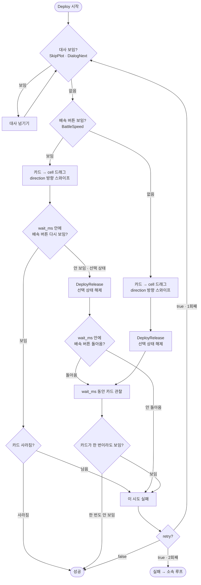

# Contributing

## 구조

```
MAARese/
├─ AGENTS.md                 에이전트 지침 (프로젝트 구조, 파이프라인 작성 규약)
├─ CLAUDE.md                 AGENTS.md 연결
├─ setup.cmd                 로컬 실행 환경 구성
├─ interface.json            GUI 태스크와 옵션
├─ resource/
│  ├─ pipeline/              파이프라인 (흐름은 docs/Flow.md)
│  ├─ image/                 템플릿 이미지
│  └─ model/ocr/             한국어 OCR 모델
├─ agent/                    커스텀 동작·인식 (모듈별 역할은 AGENTS.md 프로젝트 지도)
├─ tools/                    실행 환경 구성, 검사, 오퍼레이터 데이터 생성, 대사 문서 생성, MFAAvalonia 한국어 번역
├─ docs/
│  ├─ Flow.md                리세 흐름
│  ├─ Battle.md              전투 공통 구조와 배치
│  ├─ PipelineProtocol.md    MaaFramework 파이프라인 프로토콜 번역
│  ├─ ProjectInterfaceV2.md  MaaFramework 인터페이스 프로토콜 번역
│  ├─ PipelineSpec.md        파이프라인 필드 요약
│  ├─ gamedata/              게임 대사 원문
│  └─ images/                문서용 이미지 (MFAAvalonia 화면)
└─ .github/workflows/        GitHub Actions 워크플로
```

## 로컬 실행

```
git clone https://github.com/HX3N/MAARese.git
cd MAARese
setup.cmd
```

`setup.cmd`를 실행하면 MFAAvalonia, MaaFramework, Python을 저장소 루트에 내려받은 뒤 MFAAvalonia를 실행합니다. 필요한 런타임이 없으면 관리자 권한으로 설치를 진행합니다. 다음부터는 `MFAAvalonia.exe`만 실행하면 됩니다.

## 오퍼레이터 데이터

`agent/operator_data.json`은 저장소에 커밋되어 있고 릴리스에 그대로 들어갑니다. 새 오퍼레이터가 나오면 `./python/python.exe tools/gen_operator_data.py`로 다시 만드세요.

[ArknightsGamedata](https://github.com/ArknightsAssets/ArknightsGamedata)의 한국 서버 `character_table.json`에서 오퍼레이터 이름과 희귀도를 가져옵니다.

## MFAAvalonia 한국어 번역

- `tools/locale/ko.json`에 MFAAvalonia UI 한국어 번역이 있습니다.
- 빌드된 리소스 `tools/locale/MFAAvalonia.Core.resources.dll`을 `setup.cmd`와 릴리스 빌드가 `libs/locales/en-US/`에 덮어씁니다. 그래서 언어 설정의 `English`가 한국어로 나옵니다.
- 탭 우클릭 메뉴와 새 탭 이름은 리소스가 아니라 `MFAAvalonia.Core.dll`에 직접 들어 있습니다. `build.py`가 이 문자열만 바꾼 `tools/locale/MFAAvalonia.Core.dll`을 만들고, `setup.cmd`와 릴리스 빌드가 `libs/`에 덮어씁니다. 바꿀 문자열은 `build.py`의 `CORE_STRINGS`에 있습니다.
- `tools/versions.json`의 `mfaavalonia`를 올리거나 번역을 고치면 `setup.cmd`를 실행한 뒤 `./python/python.exe tools/locale/build.py`로 다시 빌드하세요. .NET SDK가 필요합니다. 새 버전에서 `CORE_STRINGS`의 원문을 찾지 못하면 빌드가 실패합니다.

## 의존성 버전

`tools/versions.json`에서 다음 버전을 고정합니다.

- `mfaavalonia`: MFAAvalonia
- `maafw`: MaaFramework
- `python`: embedded Python
- `maafw_pip`: 에이전트가 쓰는 MaaFramework Python 패키지

## 유의사항

- [AGENTS.md](AGENTS.md)는 에이전트 지침이며, 파이프라인 작성 규약(노드 이름, 루프 구성, `next` 순서, focus 형식, 인식 방법)도 여기에 있습니다.
- 처음 받은 뒤 `pre-commit install`을 실행해 주세요. 커밋할 때 JSON을 Prettier로 포매팅하며, 포매팅으로 바뀐 파일이 있으면 커밋이 멈추므로 다시 `git add`한 뒤 커밋하세요.
- 수정한 뒤에는 저장소 루트에서 아래 두 검사를 실행해 주세요.
  - `./python/python.exe tools/check_resource.py resource`: 리소스를 불러오고, `And`·`Or`와 `interface.json`의 `pipeline_override`가 가리키는 노드가 있는지 확인합니다.
  - `./python/python.exe tools/check_agent.py`: 파이프라인과 `interface.json`에서 쓰는 커스텀 동작·인식이 에이전트에 등록되어 있는지, 그 파라미터가 클래스의 `PARAMS`에 맞는지(모르는 키, 빠진 필수 키, 허용 값, `one_of`), `handle`·`until`·`branches`·`done`·`node`가 가리키는 노드가 있는지, `agent/main.py`가 등록 모듈을 모두 import하는지, 코드의 `_NODE`/`_NODES` 상수가 가리키는 노드가 있는지 확인합니다. 쓰이지 않는 등록 동작은 경고만 합니다.
- `next`에 없는 노드를 적으면 리소스를 불러오지 못합니다. 나눠서 커밋할 때는 다른 노드가 가리키는 노드부터 커밋하세요.
- 기기에서 확인할 때는 MFAAvalonia에서 리소스를 다시 불러온 뒤 실행하세요. 다시 불러오지 않으면 이전 파이프라인으로 실행됩니다. `debug/maafw.log`의 `recognize_list`를 보면 수정한 구조로 실행됐는지 알 수 있습니다.
- 문제가 생기면 `debug/maafw.log`에서 노드별 인식 점수와 위치를, `debug/on_error/`에서 실패한 순간의 화면을 확인하세요.
- 저장소의 `interface.json` `version`은 `0.0.0`입니다. 개발용 폴더에서는 MFAAvalonia 자동 업데이트를 켜지 마세요. 작업 중인 파일이 릴리스 파일로 덮어씌워집니다.
- 커스텀 동작이 실행 중에 노드 설정을 바꾸면(`override_pipeline`, `override_next`) 파이프라인 파일의 값 대신 바뀐 값이 쓰입니다.
- maa-support 확장은 한 노드의 `next`와 `on_error`에 같은 노드가 있으면 `Duplicate route` 오류를 표시합니다. MaaFramework는 두 목록을 따로 처리하므로 실행에는 영향이 없으며, `ClickRetry` 탈출구([AGENTS.md](AGENTS.md)의 "루프 구조")에서는 의도된 구조입니다. Problems 패널에서는 필터에 `!Duplicate route`를 넣어 숨길 수 있습니다.

## Watchdog

에이전트는 노드가 시작될 때마다 다음 일을 합니다(`agent/watchdog.py`).

- **루프 구분**: focus가 문자열인 노드를 루프로 칩니다. 맨 앞의 색 태그를 뺀 뒤 `◆`·`⚠`·`★`로 시작하는 줄과 객체로 쓴 focus는 루프로 치지 않습니다.
- **정체 복구**: `[JumpBack]` 노드가 계속 적중하는 루프는 timeout이 걸리지 않습니다. 그래서 한 루프에 `GameDownReset`의 `attach.loop_limit_min`분(interface "타임아웃", 기본 3분) 넘게 머물면 그 루프와 지금 노드의 `next`와 `on_error`를 `GameDownReset`으로 바꿔 복구로 넘어가고, 복구가 시작되기 전까지 시작되는 노드도 같이 바꿉니다. 복구가 시작되면 원래 값으로 되돌립니다. focus가 문자열이 아닌 `Gacha_Pull_Skip`이 실행될 때마다 루프 시작 시각을 다시 재므로, 뽑기 연출을 넘기는 동안은 정체로 치지 않습니다. 커스텀 동작 하나가 오래 실행되는 동안에는 시간을 확인하지 않습니다. 한도는 루프가 바뀔 때 그 값을 읽어 정합니다.

## 커스텀 동작·인식 공통 규칙

### 파라미터

- `custom_action_param`과 `custom_recognition_param`은 JSON으로 읽습니다.
- 각 클래스의 `PARAMS`가 파라미터 규격입니다. `required`는 필수 키, `optional`은 선택 키와 기본값, `choices`는 키별 허용 값, `one_of`는 적어도 하나는 있어야 하는 키 묶음입니다.
- 모르는 키, 빠진 필수 키, 허용 값 밖의 값, 모두 비어 있는 `one_of` 묶음이 있으면 `[동작 이름] param error: …`를 로그에 남깁니다. 동작은 실패해 노드의 `on_error`로 넘어가고, 인식은 적중하지 않습니다.
- 동작 실행 중 예외가 나면(`guard_run`) `[동작 이름] error: …`를 로그에 남기고 실패로 끝냅니다.
- 로그는 `[태그] 내용` 형식입니다. 태그는 등록한 동작 이름이고, 여러 동작이 함께 쓰는 보조 함수는 영역 이름(`account`, `watchdog`, `run`)을 씁니다.

### 파라미터 이름

- 시간은 `_ms`로 끝냅니다(`wait_ms`).
- 화면 영역 `[x, y, w, h]`는 `click`이고, 영역 목록이면 `rois`입니다.
- 칸 좌표 `[x, y]`는 `cell`입니다.
- 노드 이름 목록은 하는 일로 이름 짓습니다(`handle`, `until`).
- 그 밖의 목록은 복수형입니다(`templates`, `rois`).
- 기본값이 있는 키는 기본값과 같은 값을 JSON에 적지 않습니다.

### 새 동작 추가

- 등록 이름은 동사 + 대상 순서로 짓습니다(`SelectStage`).
- 클래스에 `PARAMS`를 두고 `load_params`로 파라미터를 읽습니다.
- 코드에서 파이프라인 노드 이름은 이름이 `_NODE`/`_NODES`로 끝나는 모듈 상수로 둡니다.
- 등록하는 모듈은 `agent/main.py`에서 import합니다.

## 커스텀 인식

### Dialog

대화창 첫 줄의 글자를 읽어 공백을 지운 뒤, 그 줄의 앞부분(`text` 길이만큼)이 `text`와 0.8 이상 비슷하면 인식합니다. 읽은 줄이 `text` 길이보다 짧으면(대사가 아직 다 나오지 않았으면) 인식하지 않습니다. 10자 `text`는 두 글자까지 틀려도 인식합니다. 대화창 OCR 노드의 `replace`가 원본 대사에 나오는 특수문자를 지웁니다. 인식하면 그 줄 첫 글자 영역을 돌려주므로, 노드의 `Click` 동작은 그 글자를 누릅니다.

- `area` (필수): 읽을 대화창. `upper`는 위쪽 대화창(`Public`의 `DialogArea`), `lower`는 아래쪽 대화창(`LowerDialogArea`)입니다.
- `text` (필수): 기대 문구. 정하는 법은 [AGENTS.md](AGENTS.md) "판단 조건"의 Dialog에 있습니다.

```json
{ "area": "lower", "text": "작전지점을선택하여주" }
```

### DeployReady

전투 중 오퍼레이터를 배치할 수 있는지 확인합니다. 카드는 `Battle/<operator>.png` 템플릿으로 찾습니다.

- `operator` (선택): 오퍼레이터 ID(`char_…`).
- `cost` (선택): 필요한 코스트.

넣은 파라미터에 따라 인식 조건이 다릅니다.

- `operator`만 넣으면 카드가 보일 때 인식됩니다.
- `cost`만 넣으면 코스트가 `cost` 이상일 때 인식되고, 코스트 숫자 영역을 돌려줍니다.
- 둘 다 넣으면 카드가 보이고, 코스트가 `cost` 이상이거나 카드가 밝게 켜져 있을 때 인식됩니다. 카드 영역을 돌려줍니다.

배치 노드에 어떤 조건을 거는지는 [docs/Battle.md](docs/Battle.md) 2절에 있습니다.

```json
{ "operator": "char_502_nblade", "cost": 7 }
```

### ResolutionMismatch

기기 원본 해상도가 1280×720과 다르면 인식하고, `Account_Resolution_Notice`의 안내 문구에 현재 해상도를 넣습니다. 첫 스크린샷 전이라 해상도를 읽지 못하면 인식하지 않습니다. 파라미터는 없습니다.

## 커스텀 동작

### 흐름

#### StartNode

`node`가 있으면 자기 노드의 `next`를 그 노드로 바꿉니다. `Account_Entry`에서 interface Debug의 "시작 노드"를 받습니다.

- `node` (필수): 시작할 노드 이름. 빈 문자열이면 `next`를 바꾸지 않습니다.

```json
{ "node": "Stage04" }
```

#### ClickRetry

인식된 대상을 누르고, `wait_ms` 동안 누른 자리(인식 상자 둘레 10px)에 같은 대상이 계속 보이면 한 번 더 누릅니다. 같은 모양의 다른 대상은 남은 것으로 보지 않습니다. 두 번 눌러도 남아 있으면 실패합니다. 다시 확인할 때 로딩 화면이 보이거나 `until`의 노드가 적중해도 성공으로 봅니다. 누른 뒤 화면이 늦게 바뀌는 버튼에 씁니다.

- `wait_ms` (선택): 누른 뒤 대상이 사라지기를 기다리는 최대 시간(ms). 기본값은 1500입니다.
- `click` (선택): 누를 영역 `[x, y, w, h]`. 주면 인식된 위치 대신 이 영역 가운데를 누릅니다. 다시 확인은 같은 노드의 인식으로 합니다.
- `pre_click` (선택): `true`면 인식된 대사를 먼저 눌러 출력을 끝낸 뒤 누릅니다. 기본값은 `false`입니다.
- `until` (선택): 노드 이름 목록. 다시 확인할 때 하나라도 적중하면 성공이며, 기존 성공 조건에 더해집니다.

```json
{ "wait_ms": 2000 }
```

```json
{ "click": [559, 367, 58, 81], "until": ["EarnReward"] }
```

#### RunLimit

리세 회차가 `max_runs`에 이르면 다음 노드를 비워 작업을 끝냅니다.

- `max_runs` (필수): 최대 회차. 숫자나 숫자 문자열을 받으며, 0이면 제한이 없습니다.

```json
{ "max_runs": 0 }
```

### 계정

#### AccountWipe

리세 회차를 하나 올리고 게임 데이터를 지웁니다. 로그의 게임 실행 줄은 `▶ 게임 실행 · N회차`로 바뀝니다.

#### AccountLoad

기록해 둔 계정을 기기에 되살립니다.

- `account` (필수): 불러올 계정. 스크린샷 파일 이름 앞의 시간(`YYYYMMDD-HHMMSS`)을 적습니다. `latest`나 빈 문자열이면 지금 MFAAvalonia 인스턴스에서 기록한 계정 중 가장 최근 것을 불러옵니다.

```json
{ "account": "latest" }
```

#### LaunchApp

게임을 실행합니다. 실행 출력에 `Events injected`가 없으면 실패합니다.

#### AccountSave

스크린샷을 남기고 계정 데이터를 `accounts/`에 기록합니다. 파라미터는 없으며, 지금 파이프라인에서는 쓰지 않습니다.

### 전투

#### Deploy

인식된 카드를 칸으로 끌어다 놓고 방향을 정합니다. 노드의 인식이 카드 영역을 넘겨줘야 하므로 `operator`를 넣은 `DeployReady`와 함께 씁니다. 배치하기 전에 대사가 보이면 `SkipPlotConfirm`·`SkipPlot`·`DialogNext`로 먼저 처리한 뒤 배치를 이어 갑니다. 30초 안에 배치를 마치지 못하면 실패합니다.

- `operator` (필수): 오퍼레이터 ID. 배치한 뒤 카드가 남았는지 확인할 때 씁니다.
- `cell` (필수): 놓을 칸의 화면 좌표 `[x, y]`.
- `direction` (필수): `up`·`down`·`left`·`right` 중 하나. 칸에서 그쪽으로 400px 밀어 방향을 정합니다. 드래그 전에 `Battle`의 `BattleSpeed`(우측 상단 배속 버튼)가 보였으면 스와이프 뒤 배속 버튼이 다시 보이는지로 배치를 확인하고, 보이지 않으면 선택 상태로 보고 `DeployRelease`(상단 중앙 `[596, 10, 90, 40]` 클릭)로 해제합니다. 배속 버튼이 없는 전투에서는 항상 `DeployRelease`로 해제합니다.
- `wait_ms` (선택): 배속 버튼이 돌아오기를 기다리거나 카드를 지켜보는 시간(ms). 기본값은 500입니다.
- `retry` (선택): 기본값 `true`는 시도가 실패하면 마지막으로 본 카드 위치에서 한 번 더 배치하고, 그래도 실패하면 동작이 실패합니다. `false`면 한 번만 배치하고 성공으로 끝냅니다.

```json
{
  "operator": "char_503_rang",
  "cell": [633, 466],
  "direction": "up",
  "wait_ms": 150,
  "retry": false
}
```



### 대사

#### SetSpeakers

`DialogNext`가 찾는 다이얼로그 프로필 템플릿을 바꿉니다. 구간 진입 노드에서 그 구간에 나오는 화자만 남길 때 씁니다.

- `templates` (필수): 템플릿 경로 목록.

```json
{ "templates": ["Public/DialogDonkey.png", "Public/DialogPRTS.png"] }
```

### 이벤트

#### ResetEventSlot

`OpenEventSlot`이 첫 번째 칸부터 다시 보도록 되돌립니다. 이벤트 구간에 들어갈 때마다 실행합니다. 파라미터는 없습니다.

#### OpenEventSlot

메인화면의 이벤트 칸을 차례로 열어 봅니다. 아직 보지 않은 칸에서 `branches`의 아이콘을 찾으면 그 칸을 누르고, 다음 노드를 그 아이콘에 맞는 노드로 정합니다. 남은 칸이 없으면 `done`으로 넘어갑니다.

- `rois` (필수): 칸마다의 roi 목록. 위 칸부터 적습니다.
- `branches` (필수): `{아이콘 노드: 다음 노드}`. 적은 순서대로 찾습니다.
- `done` (필수): 모든 칸을 본 뒤 넘어갈 노드.

```json
{
  "rois": [
    [0, 68, 60, 55],
    [0, 123, 60, 54],
    [0, 177, 60, 54]
  ],
  "branches": { "EventSlotCheck": "Reward-Event_Popup", "EventSlotCard": "Reward-Event_TicketPick" },
  "done": "Reward-Event_Finish"
}
```

### 이동·선택

#### Navigate

내비게이션을 열어 목적지로 이동합니다. 로딩 중에는 아무것도 누르지 않고 기다리며, 도중에 뜨는 팝업은 음성 리소스 팝업(`VoiceResourceLater`)과 `handle`의 노드로 먼저 처리합니다. 목적지가 `Home`이 아닌데 메인화면에서 시작하면 기다리지 않고 바로 떠납니다. 메인화면을 떠날 때는 작전 버튼(`HomeOperation`)을 누르고 내비게이션으로 이동하며, `direct`면 목적지 버튼(`Home<dest>`)을 바로 누르고 로딩·팝업 처리를 거쳐 내비게이션 버튼이 보이면 끝납니다. 그 밖에 메인화면에서는 팝업 없이 2초가 지난 뒤에 움직이고, 목적지가 `Home`이면 그 시점에 끝납니다. 목적지가 `Home`일 때 내비게이션에서 홈을 누른 뒤에도 같은 처리를 거쳐 메인화면이 2초 유지되면 끝납니다. 60초 안에 이동하지 못하면 실패합니다.

- `dest` (필수): 목적지. `Home`·`Squad`·`Operator`·`Operation`·`Headhunting` 중 하나이며, 내비게이션에서 `Public`의 `Nav<dest>` 노드 위치를 누르고, `direct`면 메인화면에서 `Home<dest>`를 누릅니다.
- `handle` (선택): 이동 중에 처리할 노드 목록. 기본값은 `["EarnReward", "ClosePopup"]`입니다.
- `direct` (선택): `true`면 메인화면에서 목적지 버튼으로 바로 이동합니다. 기본값은 `false`입니다.

```json
{ "dest": "Operation", "handle": ["EarnReward", "ClosePopup", "DialogNext"] }
```

#### SelectStage

0장 지도에서 스테이지를 골라 작전 개시 버튼을 띄웁니다. 지도 영역에서 스테이지 이름을 읽어(`Public`의 `StageName`) 누릅니다. 이름을 읽지 못하면 `Public/Stage/<stage>.png` 템플릿(`StageTemplate`)으로 찾되, 맞은 자리에 다른 스테이지 템플릿이 더 높은 점수로 맞으면 이웃 라벨로 보고 누르지 않습니다. 다른 스테이지가 골라져 있으면 해제하고, 보이지 않으면 지도를 넘깁니다. 60초 안에 고르지 못하면 실패합니다.

- `stage` (필수): 스테이지 이름. 도중에 대사가 보이면 `DialogNext`로 넘깁니다.

```json
{ "stage": "0-3" }
```

#### SelectOperator

빠른 편성 화면에서 오퍼레이터를 고릅니다. 목록의 위·아래 이름 줄을 읽어(`Public`의 `OperatorNameUpper`·`OperatorNameLower`) 누르고, 상세 정보의 이름(`OperatorDetailName`)이 맞으면 끝납니다. 보이지 않으면 목록을 넘깁니다. 확인 버튼은 누르지 않으므로 다음 노드에서 누릅니다. 60초 안에 고르지 못하면 실패합니다.

- `operator_name` (필수): 오퍼레이터 이름. 도중에 대사가 보이면 `DialogNext`로 넘깁니다.

```json
{ "operator_name": "히비스커스" }
```

#### SelectBanner

헤드헌팅 화면에서 위쪽 배너 표시줄을 읽어 왼쪽부터 몇 번째 배너인지로 고릅니다. 표시줄은 공개모집 아이콘 뒤에 배너마다 캡슐이 하나씩 있고, 선택된 배너의 캡슐(공개모집이면 아이콘)이 흰색입니다. 배너 수에 따라 표시줄 전체가 가운데 정렬로 움직이므로, 아이콘을 기준점으로 찾고 칸을 아이콘에서의 거리(첫 칸 +66, 칸 간격 64)로 셉니다.

1. 로딩 중이면 기다리고, 화면이 멈춘 뒤 표시줄을 읽습니다. 읽지 못하면 다시 읽습니다.
   - 회색 아이콘(`Gacha_Banner_Icon`)을 찾고, 1번 칸에 캡슐이 있으면 기준점으로 씁니다. 1~6번 칸을 왼쪽부터 보며 처음 흰 캡슐(`Gacha_Banner_Select`)인 칸이 지금 번호입니다.
   - 회색 아이콘이 없으면 흰 아이콘(`Gacha_Banner_IconSelect`) 후보 중 1번 칸에 회색 캡슐(`Gacha_Banner_Unselect`)이 있는 것을 찾아 0번(공개모집)으로 봅니다. 흰 아이콘은 밝은 배경에도 맞으므로 1번 칸 확인 없이 쓰지 않습니다.
2. 목표보다 앞이면 오른쪽(`Gacha_Banner_Right`), 뒤면 왼쪽(`Gacha_Banner_Left`) 화살표를 누릅니다. 원래 칸에서 흰 표시가 3초 안에 사라지지 않으면 클릭이 무시된 것으로 보고 3번까지 다시 누릅니다. 사라지거나 다시 눌러도 그대로이면 1로 돌아갑니다.
3. 셌던 마지막 칸에서 오른쪽을 눌러도 그대로이고, 오른쪽 화살표(`Gacha_Banner_RightArrow`, 마지막 배너에서 사라짐)도 없으면 1회로 셉니다. 다시 읽어 같은 확인이 연속 2회 맞으면 고른 번호의 배너가 없는 것으로 봅니다. 화살표가 보이는데 눌러도 그대로이면 렉으로 보고 다시 시도합니다. 배너 없음 노드 `Gacha_Banner_Missing`의 문구를 `⚠ 4번 배너 없음, 작업 종료`처럼 바꾸고, 지금 노드의 `next`를 그 노드로 바꿔 로그·토스트를 띄운 뒤 작업을 끝냅니다. 배너 수가 적게 세어졌다면 오른쪽이 실제로 움직이므로 이 판정에 들지 않습니다.

처음 표시줄을 읽으면 움직이기 전에 안내 노드 `Gacha_Banner_Guide`를 `run_task`로 실행해 로그에 `배너 목록 · 공개모집 · 1 · 2 · [3] · 4`처럼 배너 수와 지금 위치를 띄우고, 이동할 때는 `배너 이동 · [3] > [1]`처럼 출발과 목표를 덧붙입니다. 배너 수는 1번 칸부터 회색 캡슐(선택된 칸은 흰 캡슐)이 이어지는 만큼 셉니다.

네 템플릿은 녹색 마스크로 단색 부분만 남겼으므로 `method` 10001(1 − SQDIFF_NORMED)과 임계값 0.97을 씁니다. 60초 안에 고르지 못하면 실패합니다. 확장에서 이동만 확인할 때는 `Gacha_Banner_Test1`~`Gacha_Banner_Test6`을 실행합니다.

- `position` (필수): 왼쪽부터의 배너 번호 `1`~`6`. 공개모집은 세지 않습니다.

```json
{ "position": 2 }
```

### 헤드헌팅

`agent/watchdog.py`가 노드가 시작될 때 헤드헌팅 횟수를 셉니다. 10회 루프 `Gacha_PullTen`은 10회, 1회 루프 `Gacha_PullOne`(보너스 포함)은 1회로 기억했다가 `Gacha_Pull_Skip`이 실행될 때 더합니다. 이 노드들의 이름을 바꾸면 횟수를 세지 못합니다.

#### GachaOperatorScan

헤드헌팅이 끝난 뒤 오퍼레이터 목록에서 6성이 몇 명인지 판독합니다. `min_six`명 이상이면 계정을 기록하고, 결과를 로그의 `Gacha_Scan_Result`(요약)·`Gacha_Scan_Detail`(6성 이름·기록 여부) 줄에 씁니다.

- `min_six` (필수): 계정을 기록할 최소 6성 수. 0이면 항상 기록합니다.

리세 전략이 이어 가기를 정하는 진행 조건은 `Gacha_Scan_Active`의 `attach.continue_min_six`에 있습니다.

```json
{ "min_six": 0 }
```
