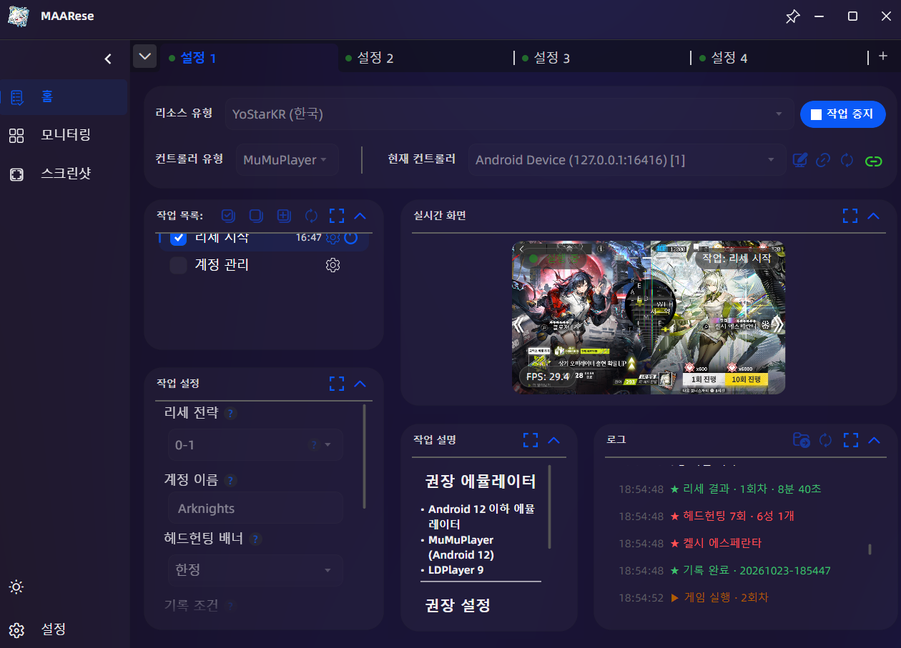
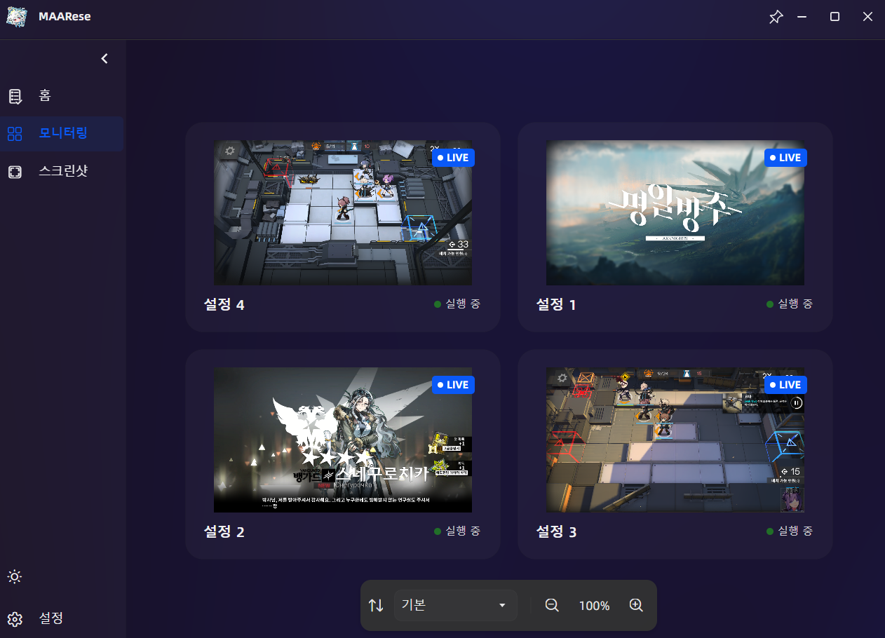
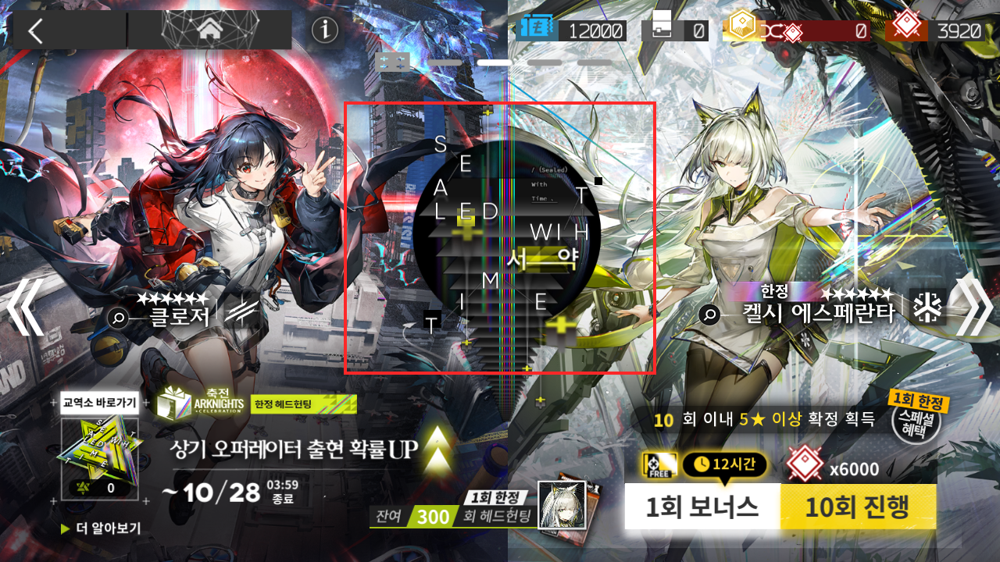
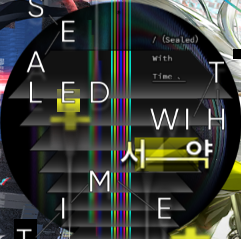

# MAARese

명일방주 한국 서버의 리세를 자동으로 반복하는 도구입니다.

## 설치

> [!IMPORTANT]
> 실행하기 전에 아래 조건을 모두 갖춰 주세요.
>
> - **Android 12 이하 에뮬레이터**
> - 에뮬레이터 설정 **1280×720 240 DPI** · **Root 권한 활성화** · **ADB 활성화** · **램 4GB 이상**
> - 리소스와 음성 다운로드를 마치고, 타이틀 화면(START)까지 들어가 본 명일방주 클라이언트

에뮬레이터는 **MuMuPlayer (Android 12)** 또는 **LDPlayer 9**을 권장합니다

구글/YoStar 계정이 로그인되어 있다면 **로그아웃을 권장**합니다.  
로그인된 상태에서도 동작은 하지만, 진행 시간이 더 오래 걸리고 불안정할 수 있습니다.

1. [Releases](https://github.com/HX3N/MAARese/releases/latest)에서 `MAARese-win-x64-<버전>.zip`(ARM PC는 `MAARese-win-arm64-<버전>.zip`)을 받아 압축을 풉니다.
2. `setup.cmd`를 실행하세요. 필요한 런타임을 관리자 권한으로 설치한 뒤 알아서 `MFAAvalonia.exe`를 실행합니다.
3. 다음부터는 `MFAAvalonia.exe`를 바로 실행하면 됩니다.

## 리세 시작

> [!TIP]
> MFAAvalonia 상단 탭의 `+`로 인스턴스를 늘리면 **동시에 여러 에뮬레이터**를 돌릴 수 있습니다.

<p>
  
  
</p>

### 리세 전략

<div align="center">

|     전략     | 진행                                                                              |               헤드헌팅               |
| :----------: | :-------------------------------------------------------------------------------- | :----------------------------------: |
|   **0-1**    | 0-1 퇴각 후 헤드헌팅                                                              |           6+1회 · 7분 이내           |
| **0-1 연장** | 0-1 퇴각 후 헤드헌팅<br>**진행 조건**을 충족하면 0-11 클리어 후 한 번 더 헤드헌팅 | 6+1회 · 7분 이내<br>25회 · 40분 이내 |
|   **0-11**   | 0-11 클리어 후 헤드헌팅                                                           |          24+1회 · 40분 이내          |

</div>

### 옵션

<div align="center">

| 옵션              | 설명                                                                                                    | 기본값       |
| ----------------- | :------------------------------------------------------------------------------------------------------ | ------------ |
| **진행 조건**     | **0-1 연장**에서 6성이 몇 개 이상이면 0-11까지 이어 갈지 정합니다.                                      | 6성 1개 이상 |
| **계정 이름**     | 한글·영어 8자 이내이며 특수문자는 쓸 수 없습니다.                                                       | Arknights    |
| **헤드헌팅 배너** | 헤드헌팅 화면에서 한정·통상·초보자 중 어떤 배너를 뽑을지 고릅니다.                                      | 한정         |
| **기록 조건**     | 6성이 몇 개 이상일 때 계정을 기록할지 정합니다.<br>`제한 없음 (비권장)`은 6성이 없어도 모두 기록합니다. | 6성 1개 이상 |
| **타임아웃**      | 한 작업이 N분 넘게 멈추면 작업을 처음부터 다시 시작합니다.                                              | 3분          |
| **반복 횟수**     | 반복할 횟수입니다.                                                                                      | 0 (무제한)   |

</div>

### 한정 배너 교체

헤드헌팅 화면에서 한정 배너는 **1회 보너스** 또는 배너 템플릿 `resource/image/LimitedBanner.png`로 알아봅니다.  
**1회 보너스**가 없는 배너인데 업데이트가 늦거나 끊겼다면, 다음 순서로 템플릿을 직접 바꿔 쓸 수 있습니다.

1. 에뮬레이터(1280×720)에서 헤드헌팅 화면에 새 한정 배너를 띄우고 스크린샷을 찍습니다.
2. roi `[440, 130, 400, 350]` 안에서 배너의 특징적인 그림(로고 등)을 잘라냅니다.
3. 잘라낸 이미지를 `resource/image/LimitedBanner.png`에 덮어씁니다.

<div align="center">

|                                                                  인식 영역 예시                                                                   |                                  템플릿 예시 `LimitedBanner.png`                                  |
| :-----------------------------------------------------------------------------------------------------------------------------------------------: | :-----------------------------------------------------------------------------------------------: |
| <a href="docs/images/limited-banner.png"></a> |  |

</div>

## 결과 확인

### 기록 폴더

기록한 계정은 `MFAAvalonia.exe`가 있는 폴더의 `accounts` 에 저장됩니다.  
스크린샷은 6성 개수별 폴더에, 계정 데이터는 `_shared_prefs`에 들어갑니다.

```
accounts/
├─ 6성_2개/
│  └─ 20261020-033645 (클로저, 엑시아 더 뉴 커버넌트).png
└─ _shared_prefs/
   └─ 20261020-033645/
```

괄호 안의 6성 이름은 OCR로 읽어서 일부가 빠질 수 있습니다. 6성 개수는 폴더 이름을 보세요.

### 실행 로그

회차마다 처음에 `▶ 게임 실행 · N회차`가 나오고, 헤드헌팅이 끝나면 아래처럼 결과가 나옵니다.

```text
★ 리세 결과 · 1회차 · 7분 0초
★ 헤드헌팅 7회 · 6성 1개
★ 클로저
★ 기록 완료 · 20261022-153012
```

계정을 기록하지 않았으면 마지막 줄이 `★ 기록 없음 · 조건 미달`입니다.

문제가 발생해 멈추면 `⚠ …`이 나오고 리세를 처음부터 다시 시작합니다.

## 계정 관리

**계정 관리** 작업은 기록한 게스트 계정을 불러오거나, 지금 계정을 직접 기록합니다.

### 불러오기

**불러올 계정**에 스크린샷 파일 이름 앞의 시간(예: `20261010-000000`)을 입력하세요.  
비워 두면 지금 실행 중인 MFAAvalonia에서 가장 최근에 기록한 계정을 불러옵니다.

### 기록하기

오퍼레이터 목록 화면에서 실행하세요. 6성을 확인한 뒤 계정을 `accounts`에 기록합니다.

## 기반 프로젝트

Framework - [MaaFramework](https://github.com/MaaXYZ/MaaFramework)  
GUI - [MFAAvalonia](https://github.com/MaaXYZ/MFAAvalonia)  
OCR - [MaaCommonAssets](https://github.com/MaaXYZ/MaaCommonAssets)  
Gamedata - [ArknightsGamedata](https://github.com/ArknightsAssets/ArknightsGamedata)
