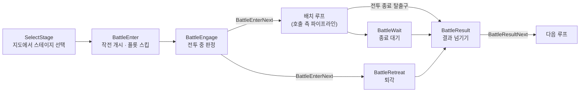
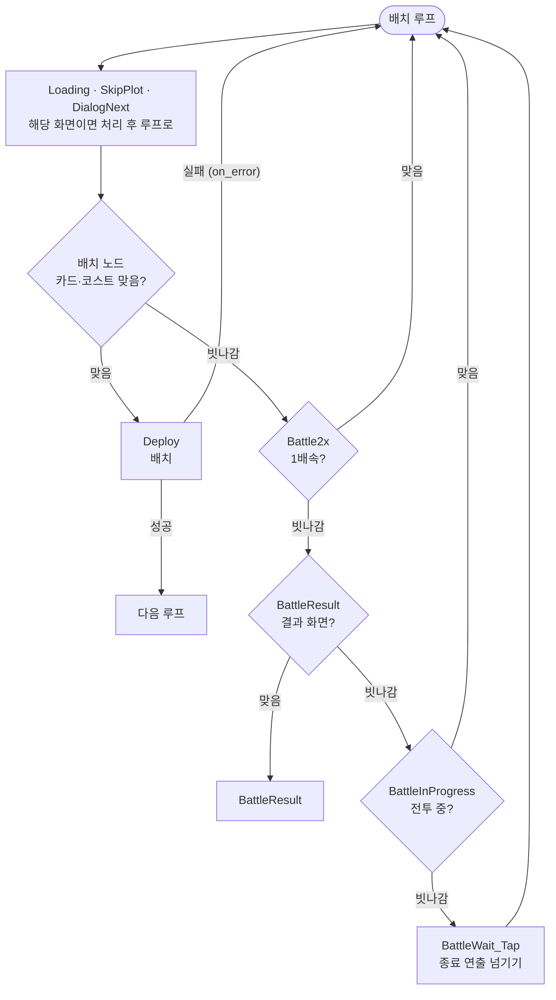

# 전투

전투 화면 처리의 공통 구조, 인식, 배치 원리를 적습니다. 언제 어느 전투에 들어가는지는 [Flow.md](Flow.md)에, 노드별 좌표·코스트 같은 값은 `resource/pipeline/`에 있습니다. 화면은 1280×720 기준입니다.

## 1. 전투 흐름

전투 공통 루프는 `resource/pipeline/Battle.json`에 있습니다. 호출하는 노드가 `anchor`로 귀환점을 정하고, 공통 루프는 `[Anchor]`로 돌아갑니다.

- `BattleEnterNext`: 전투 화면에 들어선 뒤 갈 루프(배치 루프 또는 `BattleRetreat`)
- `BattleResultNext`: 결과 화면을 넘긴 뒤 갈 루프

| 루프 | 처리 | 탈출구 → 다음 |
|---|---|---|
| `BattleEnter` | 플롯 스킵, 작전 개시 버튼 두 개(`OperationStart`·`OperationStart2`), 대사. 배속은 켜지 않습니다 | `BattleEngage` (전투 중 판정) → `BattleEnterNext` |
| 배치 루프 | 호출 측 파이프라인. [3절](#3-배치) | 마지막 배치 → `BattleWait`, 또는 전투 종료 탈출구 `BattleResult` |
| `BattleWait` | 플롯 스킵·2배속·대사·종료 연출 넘기기 반복 | `BattleResult` |
| `BattleRetreat` | `BattleEnterNext` 해제. 플롯 스킵·임무 실패·퇴각 확인·일시정지·대사 반복 | `BattleResult` |
| `BattleResult` | "종료"를 누르기 반복 | "종료"가 사라지면(`inverse`) `BattleResultNext` |

- 작전 개시 버튼은 `ClickRetry`로 눌러 화면 전환 중 연타를 막습니다. 실패 뒤 경로는 [AGENTS.md](../AGENTS.md)의 "루프 구조"·"흐름 구조"의 재확인, 동작은 [CONTRIBUTING.md](../CONTRIBUTING.md)의 ClickRetry에 있습니다. 여러 루프가 쓰는 `OperationStart`는 호출 루프가 `anchor` `OperationStartRetry`로 돌아갈 루프를 정하고(`BattleEngage`에서 해제), `BattleEnter`에서만 쓰는 `OperationStart2`는 `BattleEnter`로 돌아갑니다.
- 퇴각 버튼(`BattleExit`)도 `ClickRetry`로 누릅니다. 누른 뒤 팝업이 늦게 뜨면 루프가 퇴각 버튼을 한 번 더 눌러 열리던 팝업이 닫히므로, 팝업(`BattleExitConfirm`)이 뜨거나 버튼이 사라질 때까지 다시 누르지 않습니다(`until`, `wait_ms` 3000). 실패하면 `BattleRetreat`로 돌아갑니다.
- `BattleEngage`는 전투 화면이 잡힌 뒤 잠시 기다렸다 배치 루프로 넘깁니다. 전투 화면 직후 늦게 뜨는 대사를 배치 루프 맨 앞의 `SkipPlot`이 배치보다 먼저 넘기게 하려는 것입니다.

## 2. 인식

- **전투 중 판정**: `BattleInProgress`는 일시정지 톱니(`BattleExit`) 또는 상단 방어 포인트 아이콘(`BattleLifePoint`)이 보이면 전투 중으로 봅니다. 전투가 끝나 둘 다 사라지면 배치 루프의 `BattleInProgress`가 빗나가고 `BattleWait_Tap`이 종료 연출을 넘깁니다.
- **배속**: `Battle2x`는 배속 버튼이 1배속일 때만 보이는 템플릿으로 누릅니다.
- **코스트**: `Public`의 `DeployCost`가 고정 영역 `CostArea`와 같은 영역의 숫자를 OCR로 읽습니다. 영숫자 혼동은 `replace` 규칙으로 바로잡습니다.
  - 오퍼레이터 코스트는 잠재 1 값입니다(`character_table.json`의 `phases[0].attributesKeyFrames[0].data.cost`). 리세 계정과 TR 지급 카드는 잠재 1입니다.
- **카드**: 템플릿은 `Battle/<charId>.png` 하나이고, 공용 노드 두 개가 템플릿만 바꿔 씁니다. `DeployCard`는 배치 카드 줄에서 켜진 카드와 꺼진 카드를 모두 찾고, `DeployCardActive`는 같은 템플릿을 밝기에 민감한 방식(method 10001)으로 찾아 코스트가 차서 밝게 켜진 카드만 맞힙니다.
  - 템플릿은 코스트가 차서 밝게 켜진 카드에서 자릅니다. 어두운 카드에서 자르면 `DeployCardActive`가 꺼진 카드에 맞습니다.
  - 카드 위 플래그로 배치 가능을 판정하지 않습니다. 0-x·TR은 편성과 배치 순서가 고정이라 "배치 가능"이 "코스트 충분"과 같습니다.
- **배치 판정**: 커스텀 인식 `DeployReady {operator, cost}`
  - 파라미터는 [CONTRIBUTING.md](../CONTRIBUTING.md)의 DeployReady에 있습니다.
  - 배치 노드는 코스트(또는 켜진 카드) 조건을 함께 겁니다. 카드만 보면 코스트가 모자란 동안에도 매번 적중해 루프가 `Battle2x`까지 내려가지 않습니다.
  - TR-1 배치 노드는 예외로 `operator`만 주어 카드만 봅니다.

## 3. 배치

### 배치 루프

배치 루프의 탈출구는 배치 노드와 전투 종료 탈출구 `BattleResult` 둘입니다. 탈출구는 비-`[JumpBack]` 노드 하나라는 [AGENTS.md](../AGENTS.md)의 일반 규칙에서 배치 루프만 예외입니다. 메인 전투의 `next` 순서는 아래와 같습니다.

| 순서 | 노드 | 역할 |
|---|---|---|
| 1 | `[JumpBack]Loading` | 작업 이동 로딩 중 판정 보류 |
| 2 | `[JumpBack]SkipPlot` | 전투 중 플롯 스킵 |
| 3 | `[JumpBack]DialogNext` | 전투 튜토리얼 대사 |
| 4 | 배치 노드 | 탈출구. 카드·코스트가 맞으면 배치 |
| 5 | `[JumpBack]Battle2x` | 배치 노드 바로 뒤에 두어, 배치할 카드가 있으면 배속보다 배치가 먼저 나가게 함. 배치가 빗나가는 동안 2배속. 1배속으로 시작하는 루프에는 없음 |
| 6 | `BattleResult` | 전투 종료 탈출구. 배치 노드가 끝내 맞지 않아도 결과 화면에서 빠져나감 |
| 7 | `[JumpBack]BattleInProgress` | 코스트를 기다리는 동안 루프 유지 |
| 8 | `[JumpBack]BattleWait_Tap` | 전투가 끝나 판정이 사라지면 종료 연출 넘기기 |

- 코스트가 오르는 순서로 놓는 여러 명은 한 루프에 두고, 앞 사람들을 `[JumpBack]`으로, 가장 비싼 오퍼레이터를 탈출구로 삼습니다. 순서를 지켜야 하면 루프를 나눕니다.
- 전투 중 늦게 활성화되는 카드(숨겨진 고정 편성)는 별도 루프로 둡니다. 다른 탈출구와 같은 루프에 두면 그 카드가 배치되기 전에 루프를 빠져나갑니다.
- TR 배치 루프는 `BattleResult`·`BattleWait_Tap` 없이 `[JumpBack]Battle2x`·`[JumpBack]BattleInProgress`로 끝납니다. TR-7의 스킬 루프(`Stage09-TR7_SkillUse`)와 TR-2의 배치 루프(`Stage02-TR2_Guide`)만 `Loading` 바로 다음에 `BattleResult` 탈출구를 두고, `Stage02-TR2_Guide`는 끝에 `[JumpBack]BattleWait_Tap`도 둡니다.

### 배치 노드

| 노드 | 인식 | 동작 | 실패 시 |
|---|---|---|---|
| 탈출구 `<루프>_Exit` | Custom `DeployReady {operator, cost}` | Custom `Deploy {operator, cell, direction}` | `on_error` = 소속 루프, `next` = 다음 루프 |
| `[JumpBack]` 대상 | 같음 | 같음, `retry: false` | `on_error`·`next` 없음. 한 번 놓고 루프로 돌아감 |

- `Deploy`는 카드를 `cell` 칸으로 끌어 놓고 `direction` 방향으로 스와이프해 방향을 정합니다. 카드가 사라졌는지로 배치를 확인하고, 실패하면 `retry`가 true일 때 1회 더 하고 그래도 실패하면 소속 루프로 돌아갑니다. `retry`가 false면 한 번 놓고 성공으로 돌아갑니다. 동작은 [CONTRIBUTING.md](../CONTRIBUTING.md)의 Deploy에 있습니다.

- 가이드 배치(프롤로그 텍사스·엑시아, TR-2 아드나키엘)는 안내 대사가 시점을 정합니다. 게임데이터에서 드래그 안내(`put_down`)는 오퍼레이터를 칸에 놓을 때까지, 방향 안내(`select_direction`)는 방향을 정할 때까지 떠 있습니다. 드래그 노드는 드래그 대사를, `_Direction` 노드는 방향 대사를 인식해 각각 스와이프하고, 둘 다 `[JumpBack]`이라 배치가 끊기면 남은 대사에 맞춰 다시 처리합니다.

### 스테이지별 특이점

- TR은 레벨이 편성을 고정합니다(`level_training_N.json`의 `predefines`).
- TR-2는 튜토리얼 대기 안내를 대화창 OCR로 읽어 진행합니다. 안내에도 다이얼로그 프로필이 떠 `DialogNext`가 적중하므로 안내 노드를 `DialogNext`보다 앞에 둡니다.
- TR-3의 전투 대사는 대기 신호가 없어 `SkipPlot`으로 넘깁니다.
- TR-4는 코스트가 회복되지 않습니다(`costIncreaseTime` 9999).
- TR-7은 스킬 수동 발동을 안내합니다. 코스트 조건으로 시점을 잡아 오퍼레이터와 스킬 버튼을 누릅니다.
