# 명일방주 리세 흐름

리세 시작(`Account_Entry`)의 흐름 지도입니다. 순서는 게임데이터의 스토리 트리거로 추론하고, 각 구간을 처리하는 파이프라인을 대응시킵니다. 대사 원문은 `docs/gamedata/<경로>.md`에 순서대로 있습니다. 계정 관리(`Account_Task`)는 맨 아래 [계정 관리](#계정-관리)에 따로 적습니다. 전투 공통 구조와 배치는 [Battle.md](Battle.md)에 있습니다. 좌표·영역·대기 시간 같은 값은 `resource/pipeline/`이 원본입니다.

## 읽는 법

- **근거**: 게임데이터 경로가 있는 구간은 스토리 트리거와 튜토리얼 신호로 순서를 정했습니다. `pipeline 기준`은 게임데이터 근거가 없는 구간이며 순서는 파이프라인 구현을 따릅니다.
- **진행**
  - `터치`: 화면 아무 곳이나 터치하면 다음 대사로 넘어갑니다(PopupDialog, Tutorial `Highlight`). `DialogNext`가 처리합니다.
  - `대상 클릭`: 강조된 대상을 눌러야 신호(signal)가 와서 진행됩니다(Tutorial `Click`). 처리 방식은 [AGENTS.md](../AGENTS.md) "판단 조건"의 Dialog 항목에 있습니다.
- **대사 넘기기**: `DialogNext`가 다이얼로그 프로필을 누릅니다. 각 구간의 진입 노드가 `SetSpeakers`로 그 구간 화자만 남깁니다.

## 전체 흐름

0-1 첫 진입은 모든 리세 전략에서 퇴각합니다. 퇴각 뒤 경로는 리세 전략(`interface.json` 옵션)에 따라 갈립니다.

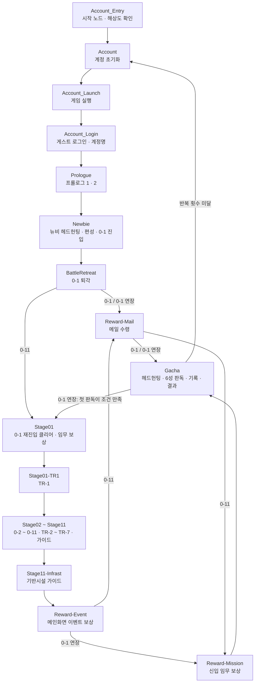

| 리세 전략 | 경로                                                                                                                                                                                                                                              |
| --------- | ------------------------------------------------------------------------------------------------------------------------------------------------------------------------------------------------------------------------------------------------- |
| 0-1       | 0-1 퇴각 → 메인화면 → 메일 → 헤드헌팅                                                                                                                                                                                                             |
| 0-1 연장  | 0-1 퇴각 → 메인화면 → 메일 → 헤드헌팅 → 6성이 진행 조건 이상이면 0-1 재진입 클리어 → 임무 보상 → TR-1 클리어 → 0-2 ~ 0-11(사이사이 TR과 가이드) → 기반시설 가이드 → 이벤트 → 신입 임무 → 10회 헤드헌팅 (6성이 진행 조건 미만이면 헤드헌팅에서 끝) |
| 0-11      | 0-1 퇴각 → 0-1 재진입 클리어 → 임무 보상 → TR-1 클리어 → 0-2 ~ 0-11(사이사이 TR과 가이드) → 기반시설 가이드 → 이벤트 → 메일 → 신입 임무 → 헤드헌팅                                                                                                |

리세 전략 옵션은 분기 노드(`◆ 분기점`)의 `enabled`를 켜고 끕니다. 헤드헌팅은 모든 전략에서 10회 뽑기로 시작하고, 순오리지늄이 모자라면 1회 뽑기로 내려갑니다. 연장은 회차의 첫 판독에서만 이어 가기를 정합니다.

## 구간별 흐름

### 1. 시작

`pipeline 기준`. `Account_Launch`가 MuMu 광고(우상단 `광고 제거` 뱃지가 보이면 그 오른쪽 ×), 리소스 다운로드 팝업(`게임 나가기`가 보이면 클릭), 음성 다운로드 선택 해제, 게임 시작·리소스 확인·업데이트·공지를 처리합니다. 시작 화면에 로그아웃 아이콘이 있으면 `Account_Logout`이 유저 센터에서 로그아웃하고 Start를 누르고, `Account_Relogin`이 계정찾기 닫기, `다른 계정 로그인`, 계정관리 두 화면, `일주일 동안 보지 않기`·`30일 동안 보지 않기` 팝업을 처리한 뒤 약관부터 `Account_Login`에 합류합니다. 두 경로가 함께 쓰는 `일주일 동안 보지 않기` 처리(`Account_Login_Sync`)는 눌러도 팝업이 남으면 호출 루프가 정한 귀환점 `LoginSyncRetry`로 돌아갑니다([AGENTS.md](../AGENTS.md)의 "흐름 구조" 재확인). 로그아웃 경로의 계정찾기·계정관리 화면은 `Account_Login`이 처리하는 화면과 달라 전용 노드(`Account_Relogin_Find`·`Account_Relogin_Manager`·`Account_Relogin_Guest`)로 처리합니다. 시작 화면을 터치하면 `Account_Login`이 게스트 로그인과 계정명 입력(옵션 "계정 이름")을 한 뒤 프롤로그로 넘어갑니다. 진입 노드 `Account_Entry`는 interface Debug의 시작 노드가 있으면 그 노드로 가고, 없으면 기기 원본 해상도가 1280×720이 아닐 때 `Account_Resolution_Notice`가 안내만 띄운 뒤 `Account`로 갑니다. `Account`(`AccountWipe`)는 게임을 종료하고 데이터를 지우고, `Account_LaunchApp`(`LaunchApp`)이 게임을 다시 실행합니다. 루트 권한이 없어 데이터를 지우지 못하면 `Account_RootFail`이, 실행하지 못하면 `Account_LaunchFail`이 안내하고 작업을 끝냅니다.

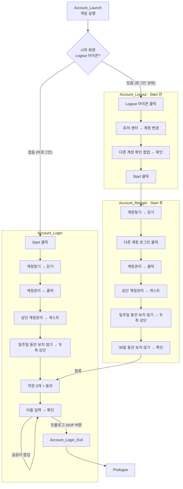

### 2. 프롤로그 1

게임데이터: [guide/beg/0_welcome_to_guide](gamedata/guide/beg/0_welcome_to_guide.md) (스킵 가능) → [tutorial/level/guide_01_a ~ guide_01_d](gamedata/tutorial/level/guide_01_a.md) → [guide/beg/1a_guide_1to2](gamedata/guide/beg/1a_guide_1to2.md) (스킵 가능).

- 플롯은 SKIP → 확인으로 넘깁니다. 스킵하지 않으면 선택지에서 멈춥니다.
- 텍사스·엑시아 배치는 드래그 안내 대사와 방향 안내 대사에 맞춰 스와이프합니다. 처리 방식은 [Battle.md](Battle.md)의 "배치 노드"에 있습니다.
- 엑시아 방향 안내가 뜨면 탈출구 `Prologue_Exit`가 프롤로그 2로 넘기고, 엑시아 방향은 프롤로그 2의 `[JumpBack]Prologue_Exusiai_Direction`이 안내가 닫힐 때까지 정합니다.
- 속도 버튼이 해금되면 2배속을 켭니다.
- 전투 중 튕겨 재접속하면 나오는 `1b_guide_1to2`는 처리하지 않습니다(재접속 경로 없음).

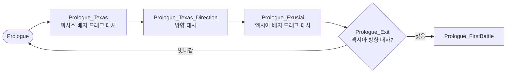

### 3. 프롤로그 2

게임데이터: [tutorial/level/guide_02_a ~ guide_02_i](gamedata/tutorial/level/guide_02_a.md) → [guide/beg/2_guide_to_home](gamedata/guide/beg/2_guide_to_home.md) (스킵 가능).

- 배치 지시가 없고 오퍼레이터는 자동 배치됩니다. 대기 신호가 있는 동작은 텍사스 선택(`char_info`)과 스킬 사용(`use_skill`)뿐입니다.
- 그 밖의 스킬은 게임데이터가 SP를 채워 주는 시점을 코스트 조건으로 잡아 누릅니다(아미야는 `guide_02_e` 직후, 리스캄·엑시아는 `guide_02_h` #2 직후). 텍사스 2회차는 SP 보장이 없어 앞 스킬 뒤 시간을 두고 누릅니다.
- 스킬을 쓸 때마다 배속 버튼이 보이지 않으면(오퍼레이터 선택 상태, 화면이 느려짐) `DeployRelease`가 상단 중앙을 눌러 선택을 풉니다. 마지막 텍사스 스킬 뒤에는 `Prologue_PostBattle`로 갑니다.

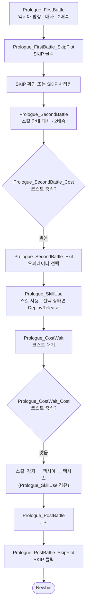

### 4. 메인 튜토리얼

게임데이터: [guide/l0-0/0_home_ui](gamedata/guide/l0-0/0_home_ui.md) → [1_recruit_adv](gamedata/guide/l0-0/1_recruit_adv.md) → [2_make_squad](gamedata/guide/l0-0/2_make_squad.md) → [3_battle_ui](gamedata/guide/l0-0/3_battle_ui.md). 모두 스킵할 수 없습니다.

- 뉴비 헤드헌팅 1회, 빈 슬롯 → 첫 카드 → 확인 편성은 모두 `대상 클릭`입니다.
- 메인화면으로 간 뒤 스토리 → 암흑시대 → 0-1을 누르고, 전투 공통 루프(`BattleEnter`)로 들어가 퇴각합니다(`BattleRetreat`).
- 퇴각 뒤 `Newbie_Result`에서 메인화면으로 간 다음 `Newbie_Branch`에서 갈립니다. 0-1 전략과 0-1 연장 전략은 메일로(`Newbie_Branch_Exit_Mail`), 0-11 전략은 `Stage01`로(`Newbie_Branch_Exit_Stage01`) 갑니다.

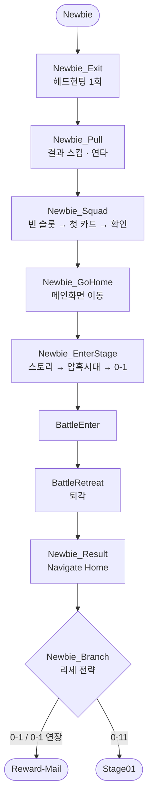

### 5. 0-1 재진입 (0-11 전략, 연장 전략의 이어 가기)

게임데이터: [main/level_main_00-01_beg](gamedata/main/level_main_00-01_beg.md) → [tutorial/level/main_00-01](gamedata/tutorial/level/main_00-01.md) → [main/level_main_00-01_end](gamedata/main/level_main_00-01_end.md).

- 첫 진입은 튜토리얼 편성(아미야·야토·느와르 코르네·레인저 + 뉴비 헤드헌팅 1명)입니다. 재진입 전에 편성에서 한 명을 빼고, 지난 작전 바로가기로 0-1에 다시 들어가 클리어합니다.
- 클리어 뒤 [guide/l0-1/0_mission_main](gamedata/guide/l0-1/0_mission_main.md)(임무 보상)이 뜨고, 보상 받기·확인은 `대상 클릭`입니다. 0-1 전략에서는 이 가이드가 나오지 않습니다.

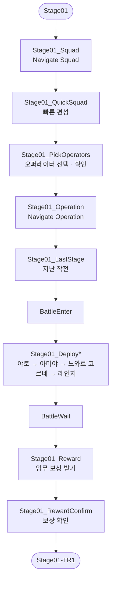

### 6. TR-1

게임데이터: [guide/l0-1/1_training_level](gamedata/guide/l0-1/1_training_level.md) (임무 보상 직후) → [tutorial/training/training_1_a](gamedata/tutorial/training/training_1_a.md) · [training_1_b](gamedata/tutorial/training/training_1_b.md).

- 가이드가 TR-1로 강제 이동시키고 작전 개시를 두 번 시킵니다. 편성 화면에서는 잠시 뒤 아미야 팝업이 작전 개시 버튼이 보이는 채로 떠 첫 클릭을 받으므로, 팝업을 넘기고 버튼을 가리키는 안내("버튼을 터치하여 튜토리얼을…")가 뜬 뒤 전투 진입 루프로 넘어갑니다.
- 전투 화면에서 레인저·야토·히비스커스를 카드가 보이는 대로 놓아 클리어합니다.

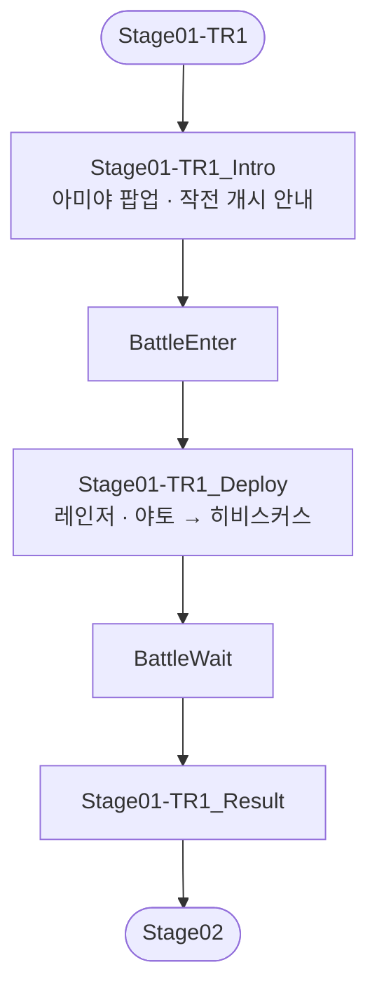

### 7. 0-2 ~ 0-11 (0-11 전략, 연장 전략의 이어 가기)

해금 순서(`stage_table` unlockCondition): 0-1 → TR-1 → 0-2 → TR-2 → 0-3 → TR-3 → 0-4 → TR-4 → 0-5 → 0-6 → TR-5 → 0-7 → TR-6 → 0-8 → 0-9 → TR-7 → 0-10 → 0-11.

- 플롯(`main/level_main_00-*`)은 모두 스킵할 수 있고, 스킵하지 않으면 선택지에서 멈출 수 있습니다.
- 전투 튜토리얼(`tutorial/level/main_00-*`)은 대사 1~3줄이고 `터치`로 넘깁니다.
- 가이드(`guide/**`)는 모두 스킵할 수 없습니다. `CUSTOM_OPERATION` 가이드는 해당 화면에 들어가거나 해당 조작(스테이지 선택 등)을 할 때 나옵니다.

**진행 순서**

0-2 → 공개모집 가이드 → TR-2 → 0-3 → TR-3 → 0-4 → 레벨업 가이드 → TR-4 → 0-5 → 0-6 → 스킬 가이드 → TR-5 → 0-7 → TR-6 → 0-8 → 0-9 → 임무 가이드 → TR-7 → 0-10 → 물자 비축 가이드 → 0-11 → 기반시설 가이드 → 이벤트. 이벤트 뒤 경로는 리세 전략에 따라 갈립니다([8. 이벤트](#8-이벤트)). 파일은 [AGENTS.md](../AGENTS.md)의 이름 규칙대로 `Stage<스테이지>`, `Stage<앞 스테이지>-<구간>`입니다.

```mermaid
flowchart LR
    T1(["Stage01-TR1"]) --> S2["Stage02"] --> R2["Stage02-Recruit"] --> TR2["Stage02-TR2"]
    TR2 --> S3["Stage03"] --> TR3["Stage03-TR3"] --> S4["Stage04"]
    S4 --> LV["Stage04-LevelUp"] --> TR4["Stage04-TR4"] --> S5["Stage05"]
    S5 --> S6["Stage06"] --> SK["Stage06-SkillUp"] --> TR5["Stage06-TR5"]
    TR5 --> S7["Stage07"] --> TR6["Stage07-TR6"] --> S8["Stage08"]
    S8 --> S9["Stage09"] --> MS["Stage09-Mission"] --> TR7["Stage09-TR7"]
    TR7 --> S10["Stage10"] --> WK["Stage10-Weekly"] --> S11["Stage11"]
    S11 --> IN["Stage11-Infrast"] --> EV(["Reward-Event"])
```

스테이지 구간의 공통 구조는 아래와 같습니다. 편성을 바꾸지 않는 스테이지(0-3·0-6·0-10·0-11)는 편성 단계 없이 곧바로 `BattleEnter`로 갑니다.

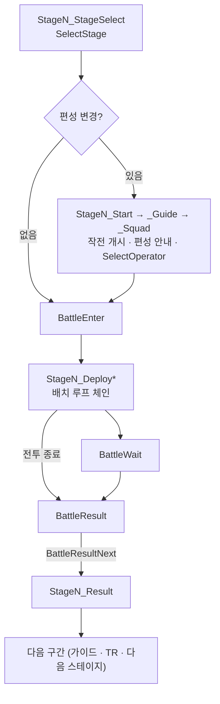

**스테이지 진입**

- 0장 지도에서 고르는 스테이지는 커스텀 동작 [`SelectStage`](../CONTRIBUTING.md#selectstage)가 처리합니다. 스테이지를 고른 직후 뜨는 대사는 다음 루프가 넘깁니다.
- 0-2는 TR-1 결과 뒤 지도에 바로 보이므로 `SelectStage` 없이 지도의 `0-2` 글자를 OCR로 찾아 누릅니다.
- 지난 작전 바로가기로 지도에 오면 그 스테이지가 선택된 상태라 먼저 해제합니다.
- 작전 화면에서 0장 지도로 들어가는 곳(0-1 재진입, 가이드 뒤 지도 복귀)은 지난 작전 바로가기를 누릅니다(0-1 재진입은 `Stage01_LastStage_Exit`, 공개모집·레벨업·스킬·임무 가이드 뒤 지도 복귀는 Public 공유 루프 `OperationLastStage`, 물자 비축 가이드 뒤는 메인화면을 거쳐 `Stage10-Weekly_Operation`).
- TR-6 통과 뒤 대리 지휘가 가능한 스테이지(`canBattleReplay`)를 처음 고르면 `guide/misc/auto_battle`(PRTS 팝업 4개, 1회)이 뜹니다. 리세 흐름에서는 0-8입니다. 팝업 뒤로 작전 개시 버튼이 보이므로 작전 개시 루프는 `DialogNext`를 `OperationStart`보다 앞에 둡니다.

**편성**

- 편성 가이드(`guide/train/tr_*`, `squad_allow_modify`)는 편성 버튼을 누른 뒤 선택 화면이 열리고 나서 "박사님, …편성해 주세요" 팝업을 띄웁니다. 그 전에 이름 줄을 누르면 팝업이 클릭을 받아 멈추므로, 팝업 대기 루프(`SquadRequestPopup`)를 앞에 두고 다음 루프에서 오퍼레이터를 고릅니다.
- 빠른 편성 선택 화면에서 오퍼레이터를 고르는 일은 커스텀 동작 [`SelectOperator`](../CONTRIBUTING.md#selectoperator)가 처리하고, 다음 노드가 확인 버튼을 누릅니다.
- 스테이지별 편성: 0-2 히비스커스(메딕), 0-4 아드나키엘(스나이퍼. TR-3 보상 제시카와 섞여 있어 이름으로 찾음), 0-5 팽(뱅가드), 0-7 두린, 0-8 12F(캐스터), 0-9 라바. 0-3·0-6·0-10·0-11은 편성을 바꾸지 않습니다.
- 0-7은 `guide/misc/assist_char`(지원 슬롯 클릭)가 `tr_05`보다 먼저 뜹니다. 가이드가 지원 화면에서 끝나 편성 화면으로 돌아가는 명령이 없으므로, 뒤로가기로 돌아온 뒤(지원 화면에 남아 있으면 다시 누름) 캐스터 편성 팝업을 기다려 빠른 편성에서 고릅니다.
- 0-9는 편성 가이드가 없어 작전 개시 루프에서 빠른 편성 버튼(`QuickSquad`)을 직접 누르고 바로 오퍼레이터를 고릅니다.

**가이드**

| 시점         | 파이프라인        | 처리                                                                                                                                                                                                  | 게임데이터                                                                                                                  |
| ------------ | ----------------- | ----------------------------------------------------------------------------------------------------------------------------------------------------------------------------------------------------- | --------------------------------------------------------------------------------------------------------------------------- |
| 0-2 결과 뒤  | `Stage02-Recruit` | 공개모집 화면의 첫 빈 슬롯 `대상 클릭`. 모집은 시작하지 않음                                                                                                                                          | [guide/l0-2/0_recruit_normal](gamedata/guide/l0-2/0_recruit_normal.md)                                                      |
| 0-4 결과 뒤  | `Stage04-LevelUp` | 첫 오퍼레이터(강조 카드 `FirstOperatorGuide`) → 레벨 영역 `대상 클릭`. 레벨업은 하지 않음                                                                                                             | [guide/l0-4/0_upgrade_char](gamedata/guide/l0-4/0_upgrade_char.md)                                                          |
| 0-6 결과 뒤  | `Stage06-SkillUp` | 첫 오퍼레이터 → 스킬 `대상 클릭`                                                                                                                                                                      | [guide/l0-6/0_upgrade_skill](gamedata/guide/l0-6/0_upgrade_skill.md)                                                        |
| 0-9 결과 뒤  | `Stage09-Mission` | 가이드가 임무 화면으로 이동. 대사만 넘김                                                                                                                                                              | [guide/l0-9/0_mission_others](gamedata/guide/l0-9/0_mission_others.md)                                                      |
| 0-10 결과 뒤 | `Stage10-Weekly`  | 물자 비축 버튼 `대상 클릭`. 가이드가 물자 비축 탭에서 끝나 메인화면을 거쳐 지도로 돌아감                                                                                                              | [guide/l0-10/0_weekly_daily](gamedata/guide/l0-10/0_weekly_daily.md)                                                        |
| 0-11 결과 뒤 | `Stage11-Infrast` | 기반시설 이동 → 건설 모드 → 방 청소 5곳 → 발전소·제조소·무역소 건설 → 일반 모드 → 제조소 오퍼레이터 배치 → 제조 설정 → 무역소 오퍼레이터 배치 → 첫 오더. 기반시설 이동은 `터치`, 나머지는 `대상 클릭` | [guide/l0-11/0_building_init](gamedata/guide/l0-11/0_building_init.md) ~ [3d_op_trade](gamedata/guide/l0-11/3d_op_trade.md) |

- 공개모집·레벨업·스킬·임무 가이드는 끝난 뒤 `Navigate {dest: Operation}` → 공유 루프 `OperationLastStage`(지난 작전 바로가기)로 0장 지도에 돌아갑니다. 작전 화면의 `stagepage_v2_intro`가 지난 작전 구역을 강조해 대사 중에도 글자가 읽히므로, 지도에서 작전 개시 버튼이 보여야 넘어갑니다.
- 기반시설 이동 안내와 기반시설 진입 뒤 AVG 대사는 탭하면 넘어가고 스킵할 수 없어, PRTS 다이얼로그 프로필은 누르고 프로필이 안 보이면 화면을 연타하다가 클로저 다이얼로그 프로필이 보이면 멈춥니다. 청소 확인과 건설 확인은 공용 노드가 처리하고, 방 루프와 그 탈출구가 귀환점 `BuildingConfirmNext`로 확인 뒤 루프를, `BuildingConfirmRetry`로 확인 실패 시 돌아올 루프를 지정합니다. 앞 루프가 앞 탈출구로 방 루프를 건너뛰어도 탈출구가 귀환점을 정합니다.
- 첫 오더 뒤 메인화면으로 이동하면서 뜨는 기반시설 나가기 확인 팝업은 `Navigate`의 handle(`InfrastLeave`)이 넘기고, 메인화면에 도착하면 이벤트로 넘어갑니다.

**전투 중 가이드·튜토리얼**

| 시점                         | 진행                                              | 게임데이터                                                                                                             |
| ---------------------------- | ------------------------------------------------- | ---------------------------------------------------------------------------------------------------------------------- |
| 공개모집 가이드 뒤 작전 화면 | 터치                                              | [guide/stage/stagepage_v2_intro](gamedata/guide/stage/stagepage_v2_intro.md)                                           |
| 0-2 편성 화면                | 빠른 편성 → 메딕 선택 → 확인                      | [guide/train/tr_01](gamedata/guide/train/tr_01.md)                                                                     |
| TR-2 전투                    | 레인저 정보 → 빈 곳 → 아드나키엘 배치 → 위쪽 방향 | [training_2_a](gamedata/tutorial/training/training_2_a.md), [training_2_b](gamedata/tutorial/training/training_2_b.md) |
| TR-3 전투                    | 야토·제시카 → 레인저 → 히비스커스 배치            | [training_3](gamedata/tutorial/training/training_3.md)                                                                 |
| 0-4 편성 화면                | 편성 변경                                         | [guide/train/tr_03](gamedata/guide/train/tr_03.md)                                                                     |
| TR-4 전투                    | 플룸 → 팽 배치                                    | [training_4_a](gamedata/tutorial/training/training_4_a.md), [training_4_b](gamedata/tutorial/training/training_4_b.md) |
| 0-5 편성 화면                | 편성 변경                                         | [guide/train/tr_04](gamedata/guide/train/tr_04.md)                                                                     |
| TR-5 전투                    | 팽·크루스·히비스커스 → 두린 배치                  | [training_5_a](gamedata/tutorial/training/training_5_a.md), [training_5_b](gamedata/tutorial/training/training_5_b.md) |
| 0-7 편성 화면                | 지원 오퍼레이터, 캐스터 편성 안내                 | [guide/misc/assist_char](gamedata/guide/misc/assist_char.md), [guide/train/tr_05](gamedata/guide/train/tr_05.md)       |
| TR-6 전투                    | 비글·12F로 다수 적 대응                           | [training_6_a](gamedata/tutorial/training/training_6_a.md), [training_6_b](gamedata/tutorial/training/training_6_b.md) |
| 0-8 지도 선택                | 대리 지휘 안내                                    | [guide/misc/auto_battle](gamedata/guide/misc/auto_battle.md)                                                           |
| 0-8 편성 화면                | 편성 변경                                         | [guide/train/tr_06](gamedata/guide/train/tr_06.md)                                                                     |
| TR-7 전투                    | 아드나키엘·쿠오라 배치 → 스킬 수동 발동           | [training_7](gamedata/tutorial/training/training_7.md)                                                                 |

### 8. 이벤트

`pipeline 기준`. 0-11 전략과 연장 전략의 이어 가기에서 기반시설 가이드가 끝난 메인화면에서 들어옵니다(`Reward-Event`).

- 메인화면 좌측 이벤트 칸은 커스텀 동작 `OpenEventSlot`이 위에서부터 훑습니다. 아직 보지 않은 칸 가운데 로그인 체크 아이콘이나 행운 티켓 아이콘이 있는 첫 칸을 누르고, 아이콘 종류에 따라 다음 루프를 정합니다. 처리를 마치면 칸 열기 루프 `Reward-Event_Slot`으로 돌아가 메인화면 유지를 확인한 뒤 다음 칸을 훑습니다.
- 로그인 팝업은 스페셜 먼슬리카드 제목 이미지가 보이면 먼슬리카드를 수령하고, 로그인 팝업이면 로그인 보상을 받습니다. 둘 다 아니면 뒤로 키로 닫고 다음 칸으로 갑니다. 행운 티켓은 세 칸을 고르고 뽑습니다.
- 보상 팝업이 뜨지 않으면 `_Retry` 노드가 같은 버튼을 다시 누릅니다.
- 남은 칸이 없으면 메인화면을 확인하고 리세 전략에 따라 갈립니다. 0-11 전략은 메일로(`Reward-Event_Finish_Exit_Mail`), 0-1 연장 전략은 메일을 건너뛰고 신입 임무로(`Reward-Event_Finish_Exit_Mission`) 갑니다.

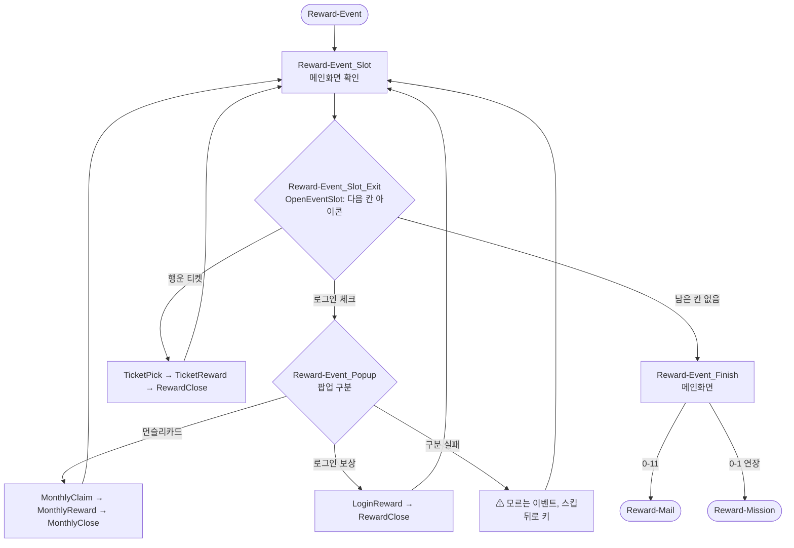

### 9. 메일

`pipeline 기준`. `Reward-Mail`. 메일은 메인화면에서 시작하며, 메인화면까지 데려오는 일은 호출부가 맡습니다(0-1 전략과 0-1 연장 전략은 `Newbie_Branch_Exit_Mail`, 0-11 전략은 이벤트).

- 보상·공지 팝업을 정리하며 메일 아이콘을 누르고, 모두 받기 버튼(`MailReceiveAll`)을 눌러 모두 받습니다.
- 끝나면 리세 전략에 따라 갈립니다. 0-1 전략과 0-1 연장 전략은 헤드헌팅 화면으로(`Navigate {dest: Headhunting}`), 0-11 전략은 메인화면을 거쳐 신입 임무로 갑니다.

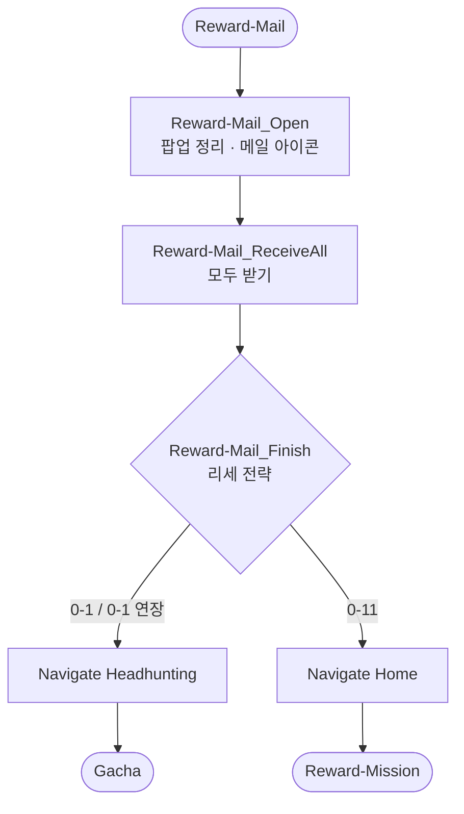

### 10. 신입 임무

`pipeline 기준`. `Reward-Mission`. 메인화면 설정 버튼으로 "로도스 적응하기" 화면을 열고 신입 임무 탭을 누릅니다. "다채로운보상"이 보이면 "획득 가능" 표시가 보이는 대로 눌러 보상을 받고, "획득 가능"이 더 보이지 않고 팝업 닫기가 보이면 닫은 뒤 헤드헌팅으로 갑니다.

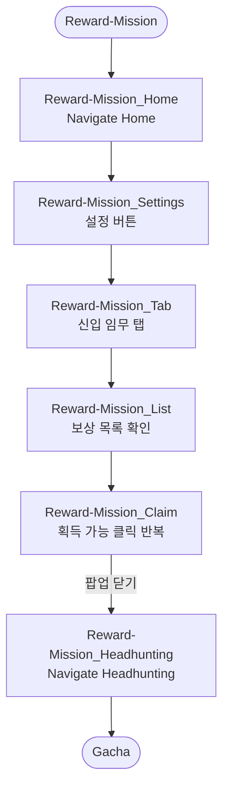

### 11. 헤드헌팅·판독

`pipeline 기준`. 고른 배너(옵션 "헤드헌팅 배너")에서 10회·1회 순으로 뽑고(1회는 보너스가 있으면 보너스부터), 오리지늄이 부족하면 6성 수를 판독합니다.

- 10회(`Gacha_PullTen`)·1회(`Gacha_PullOne`) 루프가 각각 진행 클릭·결과 스킵·팝업 처리를 반복하고, 순오리지늄 부족 팝업(`Gacha_Pull_Exit`)이 귀환점 `GachaFail`로 루프를 빠져나갑니다. 10회에서 부족하면 1회로, 1회에서 부족하면 오퍼레이터 목록을 거쳐 판독으로 갑니다. 부족·교환 팝업을 눌러도 남으면 두 루프가 정한 귀환점 `GachaPullRetry`로 진행 중이던 루프에 돌아갑니다([AGENTS.md](../AGENTS.md)의 "흐름 구조" 재확인).
- 모집 확인 팝업(`Gacha_Pull_Confirm`)은 `모집하시겠습니까` 문구로 판정해 확인을 누릅니다. 순오리지늄 부족 팝업(`Gacha_Pull_Exit`)은 순오리지늄 아이콘 템플릿으로 판정하고, 확인은 상점으로 이동하므로 취소만 누릅니다. 교환 확인이 지연돼 부족 팝업의 확인이 눌리면, 상점의 `오리지늄`·`패키지` 글자(`Gacha_Pull_Shop`)로 판정해 내비게이션으로 헤드헌팅에 돌아가고, 직전 배너에서 하던 뽑기를 이어 갑니다. 순오리지늄을 합성옥으로 교환하는 팝업(`Gacha_Pull_Exchange`)은 교환 아이콘 템플릿으로 판정해 확인을 누르며, 이 팝업에도 `모집하시겠습니까` 문구가 있으므로 `Gacha_Pull_Confirm`보다 앞에 둡니다.
- 뽑기 중에는 루프가 바뀌지 않으므로, Watchdog은 결과 스킵(`Gacha_Pull_Skip`)마다 정체 타이머를 다시 셉니다([CONTRIBUTING.md](../CONTRIBUTING.md#watchdog)의 Watchdog).
- 판독 전에 오퍼레이터 목록에서 레어도 정렬 → 뒤로가기로 메인화면 → 메인화면의 오퍼레이터 버튼으로 재진입을 거칩니다.
- 판독(`Gacha_Scan_Run`)은 이름 OCR과 6성 별 템플릿 중 큰 값을 6성 수로 봅니다. 옵션 "기록 조건"을 만족하면 계정 데이터는 `accounts/_shared_prefs/<시각>/`에, 스크린샷은 `accounts/6성_<수>개/`에 기록합니다.
- `Gacha_Scan_Result`가 회차·시간·헤드헌팅 횟수·6성 수를, `Gacha_Scan_Detail`이 6성 이름과 기록 여부를 로그에 띄웁니다(형식은 [AGENTS.md](../AGENTS.md) "실행 로그"). `Gacha_Scan_Detail`은 옵션 "반복 횟수"에 도달했으면 여기서 태스크를 끝내고, 아니면 `Account`로 다음 리세를 시작합니다. 회차는 오류로 처음부터 다시 시작한 회차도 셉니다.
- 연장 전략은 회차의 첫 판독에서 6성 수가 옵션 "진행 조건" 이상이면 `Gacha_Scan_Detail`의 다음을 `Account` 대신 `Gacha_Scan_Active`로 바꿔 `Stage01`부터 0-11까지 이어 갑니다. 이때는 반복 횟수에 도달했어도 태스크를 끝내지 않고 이어 갑니다. 두 번째 판독 뒤에는 이어 가지 않고, 반복 횟수에 도달했으면 태스크를 끝내고 아니면 `Account`로 갑니다. 두 번째 판독도 "기록 조건"대로 기록합니다.

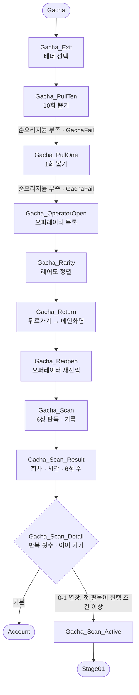

## 오류 복구

`pipeline 기준`.

| 상황                         | 처리                                                                                                                                                                                                                                                    |
| ---------------------------- | ------------------------------------------------------------------------------------------------------------------------------------------------------------------------------------------------------------------------------------------------------- |
| 노드 실패(timeout·동작 실패) | `on_error`가 없는 노드는 `GameDownReset`으로 가고, 귀환점 `GameDownNext` = `Account`가 게임을 종료하고 리세를 처음부터 다시 합니다([AGENTS.md](../AGENTS.md)의 "용어" 오류 복구) |
| 진행 정체                    | 같은 루프에 오래 머물면 Watchdog이 `GameDownReset`으로 보냅니다([CONTRIBUTING.md](../CONTRIBUTING.md#watchdog)의 Watchdog)                                                                                                                      |

- `GameDownNext`는 `Account`만 겁니다. 계정 관리에서는 귀환점이 없어 태스크가 끝납니다.

## 계정 관리

진입 노드는 `Account_Task`이고, `interface.json`의 "작업 방식"이 `next`를 정합니다.

| 작업 방식 | 흐름                                                                                                                                |
| --------- | ----------------------------------------------------------------------------------------------------------------------------------- |
| 불러오기  | `Account_Load` → `Account_Launch` → 동기화 팝업을 닫으면 태스크 끝. "불러올 계정"을 비우면 현재 인스턴스에서 가장 최근 기록을 불러옵니다 |
| 기록하기  | 오퍼레이터 목록 화면에서 실행합니다. 레어도 정렬부터 `Gacha_Scan_Run`(6성 판독·기록)까지 하고 태스크 끝                               |

## 확인이 필요한 곳

- **불러오기는 동기화 팝업에 의존합니다.** 팝업이 뜨지 않으면 계정을 불러왔더라도 태스크가 실패로 끝납니다.
- **`training_2_a`·`training_2_b`의 스킵.** HEADER에 `is_skippable`이 없어 스킵 가능 여부를 알 수 없습니다.
