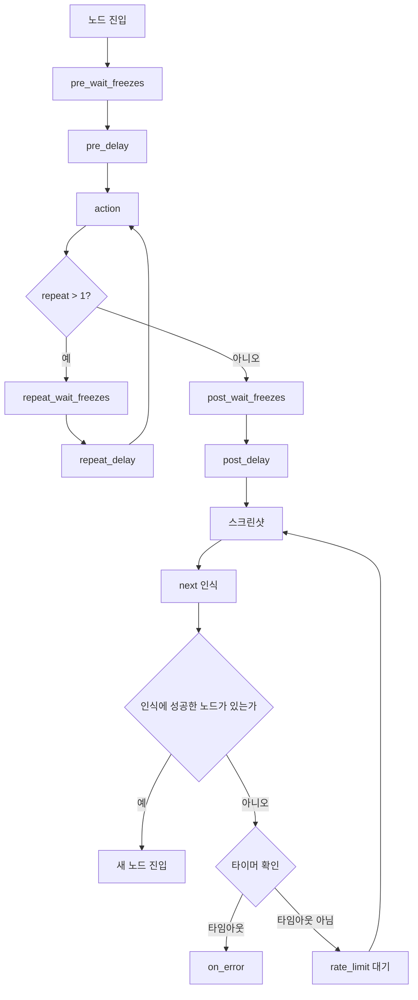
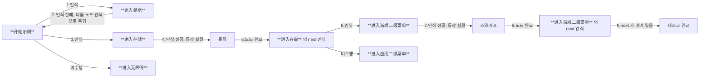
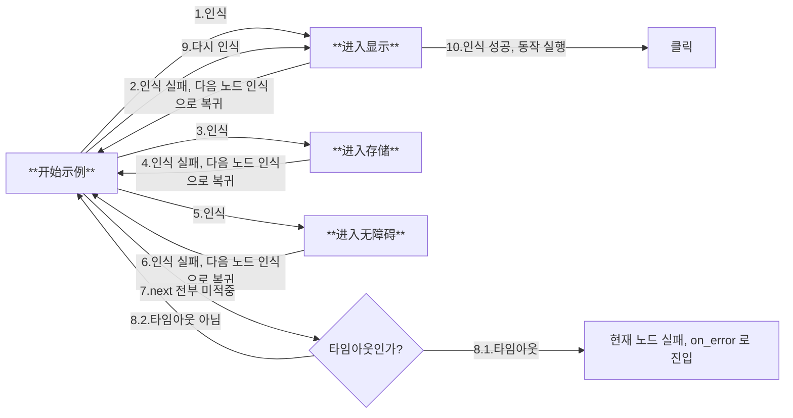
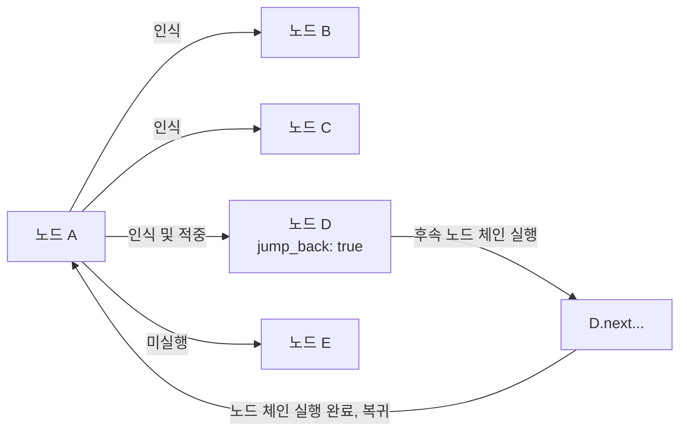

# 3.1 태스크 파이프라인(Pipeline) 프로토콜

> 원문: [MaaFramework v5.14.3 docs/zh_cn/3.1-任务流水线协议.md](https://github.com/MaaXYZ/MaaFramework/blob/v5.14.3/docs/zh_cn/3.1-任务流水线协议.md)

## 기본 형식

태스크 파이프라인은 JSON 형식으로 기술하며, 여러 노드(Node)로 구성된다. 각 노드는 다음과 같은 핵심 속성을 가진다.

```jsonc
{
    "NodeA": {
        "recognition": "OCR",    // 인식 알고리즘
        "action": "Click",       // 실행할 동작
        "next": [                // 후속 노드 목록
            "NodeB",
            "NodeC"
        ],
        // 기타 확장 속성...
    },
    // 기타 노드 정의...
}
```

## 실행 로직

### 흐름 제어 메커니즘

1. **태스크 트리거**

   - tasker.post_task 인터페이스로 진입 노드를 지정하여 태스크를 시작한다

2. **순차 검사**

   - 현재 노드의 `next` 목록을 순서대로 검사하며, 각 하위 노드를 차례로 인식해 본다
   - 이번 라운드에서 모두 적중하지 않으면 다음 라운드 검사를 계속한다. 타임아웃이 되거나 적중하는 노드가 나올 때까지 반복한다

3. **중단 메커니즘**

   - 어떤 하위 노드의 매칭이 성공한 것으로 검사되면, 이후 노드의 검사를 즉시 종료한다
   - 매칭된 노드의 `action`에 정의된 작업을 실행한다

4. **후속 처리**

   - 어떤 하위 노드의 인식이 적중하고 동작도 성공하면, 해당 노드의 `next` 목록으로 진입하여 위의 검사 흐름을 반복한다
   - 어떤 하위 노드의 인식이 적중했으나 동작이 실패하면, 해당 노드의 `on_error` 목록으로 진입한다
   - 현재 노드의 `next` 목록 인식이 타임아웃되면, 현재 노드의 `on_error` 목록으로 진입한다

### 종료 조건

다음 조건 중 하나라도 만족하면 태스크 흐름이 종료된다.

- 현재 노드의 next 목록이 비어 있다(`[JumpBack]` 복귀점이 존재하면 먼저 복귀한다)
- 현재 노드의 `next` 목록이 적중하지 못한 채 타임아웃되었다
- 외부에서 `post_stop`을 호출했거나 `StopTask` 동작이 실행되었다

## 노드 흐름

하나의 노드의 수명 주기는 다음과 같다.



## 적용 예시

### 시나리오 설명

Android 설정 화면에 `显示`/`存储`/`无障碍` 메뉴가 있으며, 이 중 `存储`를 열면 `游戏`/`应用` 2단계 메뉴가 포함되어 있다.

### 설정 예시

```jsonc
{
    "开始示例": {
        "next": [
            "进入显示",
            "进入存储",
            "进入无障碍"
        ]
    },
    "进入显示": {
        "recognition": "XXX",
        "action": "Click",
        // ...
    },
    "进入存储": {
        "recognition": "XXX",
        "action": "Click",
        "next": [
            "进入游戏二级菜单",
            "进入应用二级菜单"
        ]
    },
    "进入无障碍": {
        // ...
    },
    "进入游戏二级菜单": {
        "action": "Swipe",
        "next": []
    },
    "进入应用二级菜单": {
        // ...
    },
    // ...
}
```

### 실행 과정 추론

#### 경우 1



#### 경우 2



## 속성 필드

> [!TIP]
> **필수 필드는 Pipeline JSON 파일에서는 비워 둘 수 있으나, 실제 실행 전에 인터페이스를 통해 설정해야 한다.**  
> 점(`.`)으로 시작하는 폴더와 JSON 파일은 읽지 않는다.  
> `$`로 시작하는 JSON root field는 파싱하지 않는다.

### `roi` / `box` / `target` 구분

- `roi`: 관심 영역(Region of Interest)으로, 이미지 인식의 경계를 정의한다. 이 영역 안에서만 관련 이미지 처리를 수행한다.
- 인식 범위는 `roi`와 `roi_offset`이 함께 결정한다.
- `box`: 인식이 적중한 뒤 반환되는 매칭 영역으로, "어디에서 인식되었는가"를 나타낸다.
- `target`: 동작 실행 대상 영역으로, "어디를 클릭할지 / 어디를 스와이프할지 / 어디에서 스크롤할지"를 결정한다.
- 동작 대상은 `target`과 `target_offset`이 함께 결정한다.
- `target`의 기본값은 `true`이며, 이는 현재 인식으로 얻은 `box`를 `target`으로 사용한다는 뜻이다. 사용자가 고정 좌표, 고정 영역 또는 다른 노드를 명시적으로 지정할 수도 있다.

전형적인 흐름은 다음과 같다. 먼저 `roi`(`roi_offset` 포함) 안에서 인식하여 `box`를 얻고, 이어서 `target`(`target_offset` 포함)을 계산한 뒤 동작을 실행한다.

### 버전 변경

| 버전 | 변경 내용 |
| ---- | -------- |
| v5.0 | `attach` 필드 추가; `TouchDown` `TouchMove` `TouchUp` `KeyDown` `KeyUp` 동작 추가; Click / LongPress / Swipe / MultiSwipe에 `contact` `pressure` 필드 추가; `target`에 `[x, y]` 2원 좌표 지원 추가 |
| v5.1 | `anchor` `max_hit` 필드 추가; `Scroll` 동작 추가; 노드 속성(`jump_back` / `anchor`) 추가; `next` / `on_error`에 NodeAttr 지원 추가; `order_by`에 `Expected` 정렬 추가 |
| v5.3 | `repeat` `repeat_delay` `repeat_wait_freezes` 필드 추가; `And` `Or` 인식 유형 추가; `Shell` 동작 추가; TemplateMatch `method`에 `10001` 추가; 기본 속성(`default_pipeline.json`) 추가 |
| v5.5 | `timeout`에 `-1`(무한 대기) 지원 추가; Scroll에 `target` `target_offset` 추가 |
| v5.6 | `roi` / `target`이 음수 좌표와 크기를 지원 |
| v5.7 | `anchor`에 object 형식(대상 노드 지정 / 앵커 해제) 추가; `And` / `Or`에 노드 이름 참조 지원 추가 |
| v5.8 | OCR에 `color_filter` 필드 추가; Shell `timeout`을 `shell_timeout`으로 이름 변경; `Screencap` 동작 추가 |
| v5.9 | `roi` / `target`의 string 형식에 `[Anchor]앵커이름` 참조 지원 추가; action 실패 시 `[JumpBack]` 유무에 따라 동작이 일치하지 않던 문제 수정(오류 처리 경로에서는 복귀를 트리거하지 않음) |
| v5.10 | `TouchDown` / `KeyDown`에 `auto_up` 필드 추가. 태스크 중지·종료 또는 컨트롤러 소멸 시 아직 눌려 있는 터치 포인트/키를 자동으로 뗀다 |

### Pipeline v1

- `recognition` : *string*  
    인식 알고리즘 유형. 선택 사항이며 기본값은 [`DirectHit`](#directhit)이다.  
    선택 가능한 값: [`DirectHit`](#directhit) | [`TemplateMatch`](#templatematch) | [`FeatureMatch`](#featurematch) | [`ColorMatch`](#colormatch) | [`OCR`](#ocr) | [`NeuralNetworkClassify`](#neuralnetworkclassify) | [`NeuralNetworkDetect`](#neuralnetworkdetect) | [`And`](#and) | [`Or`](#or) | [`Custom`](#custom)  
    자세한 내용은 [알고리즘 유형](#알고리즘-유형)을 참고한다.

- `action`: *string*  
    실행할 동작. 선택 사항이며 기본값은 [`DoNothing`](#donothing)이다.  
    선택 가능한 값: [`DoNothing`](#donothing) | [`Click`](#click) | [`LongPress`](#longpress) | [`Swipe`](#swipe) | [`MultiSwipe`](#multiswipe) | [`Scroll`](#scroll) | [`ClickKey`](#clickkey) | [`LongPressKey`](#longpresskey) | [`InputText`](#inputtext) | [`StartApp`](#startapp) | [`StopApp`](#stopapp) | [`StopTask`](#stoptask) | [`Command`](#command) | [`Shell`](#shell) | [`Screencap`](#screencap) | [`Custom`](#custom-1)  
    자세한 내용은 [동작 유형](#동작-유형)을 참고한다.

- `next` : *string* | *NodeAttr* | *list<string | NodeAttr, >*  
    이어서 실행할 노드 목록. 선택 사항이며 기본값은 비어 있음이다.  
    next 안의 각 노드를 순서대로 인식하고, 처음으로 인식된 노드만 실행한다.  
    💡 v5.1 버전부터 속성이 있는 노드, NodeAttr 형식의 객체, 또는 둘을 섞은 이종 배열을 지원한다. 자세한 내용은 [노드 속성](#노드-속성)을 참고한다.

- `rate_limit`: *uint*  
    인식 속도 제한, 단위는 밀리초. 선택 사항이며 기본값은 1000이다.  
    매 인식 라운드는 최소 `rate_limit` 밀리초를 소비하며, 부족한 시간은 sleep으로 대기한다.

- `timeout`: *int*  
    현재 **노드**의 `next` 목록 인식 타임아웃(참고: [흐름도](#노드-흐름)), 단위는 밀리초. 선택 사항이며 기본값은 20 * 1000(20초)이다.  
    *현재 노드의 `recognition` 인식 대기 시간을 조정하려면, 현재 노드가 아니라 이전 노드의 `timeout` 속성을 조정해야 한다.*
    -1로 설정하면 무한 대기하며 타임아웃되지 않는다. **💡 v5.5**  
    대략 `while(!hit && !timeout) { foreach(next); sleep_until(rate_limit); }`로 이해할 수 있다.

- `on_error` : *string* | *NodeAttr* | *list<string | NodeAttr, >*  
    **이 노드** 안의 `next` 목록에서 어떤 노드도 적중하지 못한 채 반복 인식이 타임아웃되었거나, 동작 실행이 실패한 뒤에 실행할 노드 목록이다(참고: [흐름도](#노드-흐름)). 선택 사항이며 기본값은 비어 있음이다.  
    *현재 노드의 `recognition` 인식 대기 시간을 초과한 뒤에 작업을 실행하려면, 현재 노드가 아니라 이전 노드의 `on_error` 속성을 조정해야 한다.*  
    💡 v5.1 버전부터 속성이 있는 노드, NodeAttr 형식의 객체, 또는 둘을 섞은 이종 배열을 지원한다. 자세한 내용은 [노드 속성](#노드-속성)을 참고한다.

- `anchor`: *string* | *list<string, >* | *object* **💡 v5.1**  
    앵커 이름. 선택 사항이며 기본값은 비어 있음이다.  
    노드의 인식이 적중하고 동작이 실행되면(동작의 성공·실패 여부와 무관하게) 해당 앵커 이름이 이 노드를 가리키도록 설정된다. 여러 노드가 같은 앵커 이름을 설정할 수 있으며, 나중에 실행된 것이 먼저 실행된 것을 덮어쓴다.  

    세 가지 형식을 지원한다.

  - **문자열**: `"anchor": "MyAnchor"` - 앵커를 현재 노드로 설정한다
  - **문자열 배열**: `"anchor": ["A", "B"]` - 여러 앵커를 모두 현재 노드로 설정한다
  - **객체** **💡 v5.7**: `"anchor": {"A": "TargetNode", "B": ""}` - 앵커 A를 TargetNode로 설정하고, 앵커 B는 해제한다(빈 문자열은 해당 앵커를 해제한다는 뜻이다)

    `next` 또는 `on_error`에서 `[Anchor]` 속성으로 이 앵커를 참조할 수 있으며, 런타임에는 해당 앵커를 마지막으로 설정한 노드로 해석된다. 참조한 앵커가 설정되지 않았거나 이미 해제된 경우 해당 노드는 건너뛴다(실행되지 않는다).  
    자세한 내용은 [노드 속성](#노드-속성)을 참고한다.

- `inverse`: *bool*  
    인식 결과를 반전한다. 인식된 것은 인식되지 않은 것으로, 인식되지 않은 것은 인식된 것으로 간주한다. 선택 사항이며 기본값은 false이다.  
    이렇게 인식된 노드는 실제로는 아무것도 인식하지 않았으므로 Click 등 동작의 자기 자신 클릭이 무효가 된다는 점에 유의한다. 필요하다면 `target`을 별도로 설정한다.  

- `enabled`: *bool*  
    해당 node를 활성화할지 여부. 선택 사항이며 기본값은 true이다.  
    false이면 다른 node의 next 목록에 있는 이 node는 건너뛰며, 인식도 실행도 되지 않는다.

- `max_hit`: *uint* **💡 v5.1**  
    해당 노드가 최대 몇 번까지 인식에 성공할 수 있는지. 선택 사항이며 기본값은 UINT_MAX로, 제한이 없다.  
    이 횟수를 초과하면 다른 node의 next 목록에 있는 이 node는 건너뛰며, 인식도 실행도 되지 않는다.

- `pre_delay`: *uint*  
    인식된 시점부터 동작 실행 전까지의 지연, 단위는 밀리초. 선택 사항이며 기본값은 200이다.  
    가능한 한 중간 과정 노드를 늘리고 지연은 적게 쓰는 것을 권장한다. 그렇지 않으면 느릴 뿐 아니라 불안정하다.

- `post_delay`: *uint*  
    동작 실행 후부터 next 인식 전까지의 지연, 단위는 밀리초. 선택 사항이며 기본값은 200이다.  
    가능한 한 중간 과정 노드를 늘리고 지연은 적게 쓰는 것을 권장한다. 그렇지 않으면 느릴 뿐 아니라 불안정하다.

- `pre_wait_freezes`: *uint* | *object*  
    인식된 시점부터 동작 실행 전까지, 화면이 멈출 때까지 기다리는 시간, 단위는 밀리초. 선택 사항이며 기본값은 0으로, 기다리지 않는다.  
    연속 `pre_wait_freezes` 밀리초 동안 화면에 **큰 변화가 없어야** 동작으로 넘어간다.  
    object이면 더 많은 매개변수를 설정할 수 있으며, 자세한 내용은 [화면 정지 대기](#화면-정지-대기)를 참고한다.  
    구체적인 순서는 `pre_wait_freezes` - `pre_delay` - `action` - `post_wait_freezes` - `post_delay`이다.

- `post_wait_freezes`: *uint* | *object*  
    동작 실행 후부터 next 인식 전까지, 화면이 멈출 때까지 기다리는 시간, 단위는 밀리초. 선택 사항이며 기본값은 0으로, 기다리지 않는다.  
    나머지 로직은 `pre_wait_freezes`와 같다.

- `repeat`: *uint* **💡 v5.3**  
    동작 반복 실행 횟수. 선택 사항이며 기본값은 1로, 반복하지 않는다.  
    실행 흐름은 `action` - [`repeat_wait_freezes` - `repeat_delay` - `action`] × (repeat-1)이다.  
    반복 도중 한 번의 동작이 실패해도 일찍 중단하지 않으며, 최종 결과는 마지막 동작을 기준으로 한다.

- `repeat_delay`: *uint* **💡 v5.3**  
    동작을 반복할 때마다 그 사이의 지연, 단위는 밀리초. 선택 사항이며 기본값은 0이다.  
    `repeat` > 1일 때만 적용되며, 두 번째 이후의 각 동작을 실행하기 전에 대기한다.

- `repeat_wait_freezes`: *uint* | *object* **💡 v5.3**  
    동작을 반복할 때마다 그 사이에 화면이 멈출 때까지 기다리는 시간, 단위는 밀리초. 선택 사항이며 기본값은 0으로, 기다리지 않는다.  
    `repeat` > 1일 때만 적용되며, 두 번째 이후의 각 동작을 실행하기 전에 화면이 정지하기를 기다린다.  
    object이면 더 많은 매개변수를 설정할 수 있으며, 자세한 내용은 [화면 정지 대기](#화면-정지-대기)를 참고한다.

- `focus`: *object*  
    관심 노드로, 일부 콜백 메시지를 추가로 발생시킨다. 선택 사항이며 기본값은 null로, 콜백 메시지를 발생시키지 않는다.  
    각 메시지 유형의 값은 `string`(기존 동작이며 `display: "log"`와 동일) 또는 `object`(새 동작이며 `display`를 지정할 수 있음)를 지원한다.  
    자세한 내용은 [노드 알림](#노드-알림)을 참고한다.

- `attach`: *object* **💡 v5.0**  
    노드의 부가 설정을 저장하기 위한 부가 JSON 객체. 선택 사항이며 기본값은 빈 객체이다.  
    이 필드에는 사용자 정의 설정 정보를 저장할 수 있다. 이 정보는 노드의 실행 로직에는 영향을 주지 않지만 관련 인터페이스로 가져올 수 있다.  
    **주의**: 이 필드는 기본값의 `attach`와 덮어쓰기가 아니라 딕셔너리 병합(dict merge)된다. 즉 노드의 `attach`가 기본값의 `attach`와 병합되며, 같은 키의 값은 노드의 값으로 덮어써지고 그 밖의 키는 유지된다.

### Pipeline v2

> [!NOTE]
> MaaFW는 v4.4.0 버전부터 Pipeline v2 프로토콜을 지원하며 v1과도 호환된다.

v1과 비교하면, 주로 `recognition`과 `action` 관련 필드를 2단계 딕셔너리로 옮겼다(유형은 `type` 필드에, 나머지 매개변수는 `param` 필드에 둔다). 그 밖에는 차이가 없다. 예시는 다음과 같다.

```jsonc
{
    "NodeA": {
        "recognition": {
            "type": "TemplateMatch",
            "param": {
                // 인식 관련 필드는 recognition.param 안에 넣으며, 키와 값은 변하지 않는다
                "template": "A.png",
                "roi": [100, 100, 10, 10]
            }
        },
        "action": {
            "type": "Click",
            "param": {
                // 동작 관련 필드는 action.param 안에 넣으며, 키와 값은 변하지 않는다
                "target": "XXX"
            }
        },
        // recognition과 action 이외의 필드는 v1과 변함없다
        "next": ["NodeB"],
        "pre_delay": 1000,
        // ...
    }
}
```

### 기본 속성

**💡 v5.3**  
[`default_pipeline.json`](https://github.com/MaaXYZ/MaaFramework/blob/main/sample/resource/default_pipeline.json)을 참고한다.

`default_pipeline.json`은 모든 노드와 특정 알고리즘/동작 유형에 기본 매개변수를 설정하여 중복 설정을 줄이는 데 쓰인다. 이 파일은 리소스 로드 시 자동으로 읽히며, 그 안의 설정은 기본값의 토대로서 모든 노드에 상속된다.

#### 설정 구조

```jsonc
{
    "Default": {
        // 공통 필드의 기본값으로, 모든 노드에 적용된다
        "rate_limit": 1000,
        "timeout": 20000,
        "pre_delay": 200
    },
    "TemplateMatch": {
        // TemplateMatch 알고리즘의 기본 매개변수
        // v1 또는 v2 형식을 사용할 수 있다
        "recognition": "TemplateMatch",  // v1 형식: 루트 객체에 직접 작성
        "threshold": 0.7
        // 또는 v2 형식 사용:
        // "recognition": { "type": "TemplateMatch", "param": { "threshold": 0.7 } }
    },
    "Click": {
        // Click 동작의 기본 매개변수
        "action": "Click",  // v1 형식
        "target": true
        // 또는 v2 형식 사용:
        // "action": { "type": "Click", "param": { "target": true } }
    }
}
```

#### 필드 설명

- `Default` 객체: 모든 Pipeline 공통 필드의 기본값(`rate_limit`, `timeout`, `pre_delay`, `post_delay` 등)을 설정할 수 있다
- **알고리즘 이름 객체**(`TemplateMatch`, `OCR`, `FeatureMatch` 등): 해당 인식 알고리즘 유형의 기본 매개변수를 설정할 수 있다
- **동작 이름 객체**(`Click`, `Swipe`, `StartApp` 등): 해당 동작 유형의 기본 매개변수를 설정할 수 있다

#### 상속 우선순위

매개변수의 우선순위는 높은 것부터 낮은 것 순으로 다음과 같다.

1. 노드에 직접 정의된 매개변수
2. `default_pipeline.json`에서 해당 알고리즘/동작 유형의 기본 매개변수
3. `default_pipeline.json`의 `Default` 객체의 기본 매개변수
4. 프레임워크 내장 기본값

#### 사용 예시

`default_pipeline.json`이 다음과 같이 설정되어 있다고 하자.

```jsonc
{
    "Default": {
        "rate_limit": 2000
    },
    "TemplateMatch": {
        "recognition": "TemplateMatch",
        "threshold": 0.7
    }
}
```

Pipeline JSON에서는 다음과 같다.

```jsonc
{
    "NodeA": {
        "recognition": "TemplateMatch",
        "template": "A.png"
        // rate_limit은 Default의 2000을 상속한다
        // threshold는 TemplateMatch의 0.7을 상속한다
    },
    "NodeB": {
        "recognition": "TemplateMatch",
        "template": "B.png",
        "threshold": 0.9,  // 기본값을 덮어씀
        "rate_limit": 1000 // 기본값을 덮어씀
    }
}
```

#### 주의 사항

- `default_pipeline.json`은 리소스 번들(Bundle)의 루트 디렉터리, 즉 `pipeline` 폴더와 같은 계층에 두어야 한다
- 알고리즘/동작 객체의 키 이름은 해당 알고리즘/동작 유형 이름(`TemplateMatch`, `OCR`, `Click` 등)과 완전히 일치해야 하며, 대소문자를 구분한다
- `attach` 필드는 덮어쓰기가 아니라 딕셔너리 병합(dict merge)된다. 즉 노드의 `attach`가 기본값의 `attach`와 병합된다
- 어떤 기본 설정이 필요하지 않다면, 노드에서 다른 값으로 명시적으로 설정하기만 하면 덮어쓸 수 있다

#### 다중 Bundle 로드 동작

여러 Bundle을 차례로 로드할 때는 다음과 같다.

- 각 Bundle의 `default_pipeline.json`은 순서대로 병합(dict merge)되며, 나중에 로드된 같은 이름의 필드가 먼저 로드된 것을 덮어쓴다
- **이미 로드된 노드는 이후 Bundle의 `default_pipeline.json`의 영향을 받지 않는다**
- 각 노드는 처음 로드될 때의 병합된 기본값을 사용하며, 이후에는 변하지 않는다
- 각 Bundle의 `image` 폴더에서 같은 경로의 이미지는 나중에 로드된 Bundle을 기준으로 한다. 파일이면 마지막에 로드된 Bundle의 것만 사용하고, 폴더이면 상대 경로를 기준으로 병합하되 상대 경로가 같은 파일은 나중에 로드된 Bundle의 것을 취한다

**예시:** `Bundle_Base` → `Bundle_Debug`

```jsonc
// Bundle_Base/default_pipeline.json
{ "Default": { "rate_limit": 2000 } }

// Bundle_Base/pipeline/main.json
{ "NodeA": { "recognition": "OCR" } }  // rate_limit: 2000 사용

// Bundle_Debug/default_pipeline.json  
{ "Default": { "rate_limit": 100 } }   // 기본값을 덮어씀

// Bundle_Debug/pipeline/debug.json
{ "NodeB": { "recognition": "OCR" } }  // rate_limit: 100 사용
```

로드 후 `NodeA`는 `rate_limit: 2000`을 유지하고, `NodeB`는 `rate_limit: 100`을 사용한다.

#### 모범 사례: 특수 설정 분리

특수 설정이 필요한 노드를 별도의 Bundle로 구성하고 전용 `default_pipeline.json`을 설정하면 설정을 격리할 수 있다.

**예시:** 디버그 노드를 독립 Bundle로 분리

```cpp
MaaResourcePostPath(resource, "resource/base");   // base 노드는 rate_limit: 2000 사용
MaaResourcePostPath(resource, "resource/debug");  // debug 노드는 rate_limit: 100 사용
```

이미 로드된 노드는 이후의 기본값에 영향을 받지 않으므로, `base` Bundle의 노드는 기존 설정을 유지하고 `debug` Bundle의 노드는 새 기본값을 사용한다.

## 알고리즘 유형

### `DirectHit`

바로 적중시킨다. 즉 인식을 수행하지 않고 곧바로 동작을 실행한다.  

이 알고리즘 속성에는 다음과 같은 추가 필드가 필요하다.

- `roi`: *array<int, 4>* | *string*  
    관심 영역(ROI)으로, 이미지 인식의 경계를 정의하며 이 영역 안에서만 관련 이미지 처리를 수행한다. 선택 사항이며 기본값은 [0, 0, 0, 0]으로, 전체 화면이다.  
  - *array<int, 4>*: 인식 영역 좌표 [x, y, w, h]. 음수를 지원한다 **💡 v5.6**: x/y가 음수이면 오른쪽/아래쪽 가장자리를 기준으로 계산한다. w/h가 0이면 가장자리까지 확장하며, 음수이면 절댓값을 취하고 (x, y)를 우하단 모서리로 간주한다.
  - *string*: 노드 이름을 입력한다. 이전에 실행된 어떤 노드가 인식한 대상 범위 안에서 인식한다. `[Anchor]앵커이름` 형식으로 앵커에 대응하는 노드를 참조하는 것도 지원한다 **💡 v5.9**. 참조한 이전 노드 또는 앵커의 인식 결과가 비어 있으면 인식 실패로 간주한다.  

- `roi_offset`: *array<int, 4>*  
    `roi`를 기준으로 추가로 이동시킨 값을 범위로 사용한다. 네 값을 각각 더한다. 선택 사항이며 기본값은 [0, 0, 0, 0]이다.

### `TemplateMatch`

템플릿 매칭, 즉 "이미지 찾기"이다.  

이 알고리즘 속성에는 다음과 같은 추가 필드가 필요하다.

- `roi`: *array<int, 4>* | *string*  
    `DirectHit`.`roi`와 같다.

- `roi_offset`: *array<int, 4>*  
    `DirectHit`.`roi_offset`과 같다.

- `template`: *string* | *list<string, >*  
    템플릿 이미지 경로로, `image` 폴더 기준의 상대 경로가 필요하다. 필수.  
    사용하는 이미지는 무손실 원본 이미지를 720p로 축소한 뒤 잘라낸 것이어야 한다. [이미지 파일](https://github.com/MaaXYZ/MaaFramework/blob/v5.14.3/docs/zh_cn/1.1-快速开始.md#图片文件)을 참고한다.  
    폴더 경로를 입력할 수 있으며, 그 안의 모든 이미지 파일을 재귀적으로 로드한다.  
    여러 Bundle에 같은 경로의 이미지가 있을 때의 덮어쓰기 규칙은 [다중 Bundle 로드 동작](#다중-bundle-로드-동작)을 참고한다.

- `threshold`: *double* | *list<double, >*  
    템플릿 매칭 임계값. 선택 사항이며 기본값은 0.7이다.  
    배열이면 길이가 `template` 배열의 길이와 같아야 한다.

- `order_by`: *string*  
    결과 정렬 방식. 선택 사항이며 기본값은 [`Horizontal`](#horizontal)이다.  
    선택 가능한 값: [`Horizontal`](#horizontal) | [`Vertical`](#vertical) | [`Score`](#score) | [`Random`](#random).  
    `index` 필드와 함께 사용할 수 있다.

- `index`: *int*  
    몇 번째 결과를 적중으로 삼을지. 선택 사항이며 기본값은 0이다.  
    결과가 총 N개라면 `index`의 값 범위는 [-N, N - 1]이며, 음수는 Python과 유사한 규칙으로 N - index로 변환한다. 범위를 벗어나면 현재 인식에 결과가 없는 것으로 간주한다.

- `method`: *int*  
    템플릿 매칭 알고리즘, 즉 cv::TemplateMatchModes. 선택 사항이며 기본값은 5이다.  
    자세한 내용은 [OpenCV 공식 문서](https://docs.opencv.org/4.x/df/dfb/group__imgproc__object.html)를 참고한다.  
    *10001은 TM_SQDIFF_NORMED의 반전 버전으로, 점수가 높을수록 더 잘 매칭된다(원래 버전과 반대).* **💡 v5.3**

    | method | 알고리즘 이름 | 속도 | 색상 민감도 | 조명 강건성 | 적합한 시나리오 |
    | ------ | ------- | ---- | --------- | --------- | ------- |
    | 10001 | TM_SQDIFF_NORMED (Inverted) **💡 v5.3** | 빠름 | 민감 | 나쁨 | 정밀 매칭, 임계값 설정이 쉬움 |
    | 3 | TM_CCORR_NORMED | 보통 | 민감 | 보통 | 템플릿이 밝을 때 효과가 좋음 |
    | 5 | TM_CCOEFF_NORMED | 비교적 느림 | 둔감 | 좋음 | **권장**, 임계값 설정이 쉬움 |

- `green_mask`: *bool*  
    녹색 마스크를 적용할지 여부. 선택 사항이며 기본값은 false이다.  
    true이면 이미지에서 매칭하고 싶지 않은 부분을 녹색 RGB: (0, 255, 0)으로 칠할 수 있으며, 녹색 부분은 매칭하지 않는다.  
    주의: 알고리즘 자체의 강건성이 높아 일반적인 배경 변화에는 보통 이 기능이 필요하지 않다. 꼭 써야 한다면 방해가 되는 영역만 가리고, 과도하게 칠해 주체의 가장자리 특징이 사라지지 않도록 한다.

### `FeatureMatch`

특징 매칭으로, 일반화 능력이 더 강한 "이미지 찾기"이다. 원근 변화와 크기 변화에 강하다는 특징이 있다.  

이 알고리즘 속성에는 다음과 같은 추가 필드가 필요하다.

- `roi`: *array<int, 4>* | *string*  
    `DirectHit`.`roi`와 같다.

- `roi_offset`: *array<int, 4>*  
    `DirectHit`.`roi_offset`과 같다.

- `template`: *string* | *list<string, >*  
    템플릿 이미지 경로로, `image` 폴더 기준의 상대 경로가 필요하다. 필수.  
    폴더 경로를 입력할 수 있으며, 그 안의 모든 이미지 파일을 재귀적으로 로드한다.  
    여러 Bundle에 같은 경로의 이미지가 있을 때의 덮어쓰기 규칙은 [다중 Bundle 로드 동작](#다중-bundle-로드-동작)을 참고한다.  
    주의 사항:
  - 템플릿 이미지는 너무 작지 않아야 하며, 최소 64x64 픽셀을 권장한다. 그렇지 않으면 특징점이 너무 적어 매칭에 실패하거나 오매칭이 발생할 수 있다.
  - 템플릿에는 충분한 질감 디테일(가장자리, 모서리 등)이 있어야 한다. 단색이나 그라데이션 영역은 특징점이 드물다.
  - 템플릿에 반복되는 질감(격자, 줄무늬 등)이 많이 포함되지 않도록 한다. 특징점 매칭이 혼란스러워질 수 있다.

- `count`: *uint*  
    매칭된 특징점의 최소 개수 요구치(임계값). 선택 사항이며 기본값은 4이다.  

- `order_by`: *string*  
    결과 정렬 방식. 선택 사항이며 기본값은 [`Horizontal`](#horizontal)이다.  
    선택 가능한 값: [`Horizontal`](#horizontal) | [`Vertical`](#vertical) | [`Score`](#score) | [`Area`](#area) | [`Random`](#random).  
    `index` 필드와 함께 사용할 수 있다.

- `index`: *int*  
    몇 번째 결과를 적중으로 삼을지. 선택 사항이며 기본값은 0이다.  
    결과가 총 N개라면 `index`의 값 범위는 [-N, N - 1]이며, 음수는 Python과 유사한 규칙으로 N - index로 변환한다. 범위를 벗어나면 현재 인식에 결과가 없는 것으로 간주한다.

- `green_mask`: *bool*  
    녹색 마스크를 적용할지 여부. 선택 사항이며 기본값은 false이다.  
    true이면 이미지에서 매칭하고 싶지 않은 부분을 녹색 RGB: (0, 255, 0)으로 칠할 수 있으며, 녹색 부분은 매칭하지 않는다.  
    주의: 알고리즘 자체의 강건성이 높아 일반적인 배경 변화에는 이 기능이 필요하지 않다. 꼭 써야 한다면 방해가 되는 영역만 가리고, 과도하게 칠해 주체의 가장자리 특징이 사라지지 않도록 한다.

- `detector`: *string*  
    특징 검출기. 선택 사항이며 기본값은 `SIFT`이다.  

    | 검출기 | 속도 | 스케일 불변성 | 회전 불변성 | 정밀도 | 적합한 시나리오 |
    | ----- | ---- | --------- | --------- | ---- | ------- |
    | SIFT | 느림 | 있음 | 있음 | 최고 | **권장**, 정밀도 요구가 높은 시나리오 |
    | KAZE | 비교적 느림 | 있음 | 있음 | 높음 | 2D/3D 이미지, 가장자리 보존이 좋음 |
    | AKAZE | 보통 | 있음 | 있음 | 비교적 높음 | 속도와 정밀도의 균형 |
    | BRISK | 빠름 | 있음 | 있음 | 보통 | 실시간성 요구가 높은 시나리오 |
    | ORB | 가장 빠름 | **없음** | 있음 | 비교적 낮음 | 템플릿과 대상의 크기가 같을 때 사용 |

- `ratio`: *double*  
    KNN 매칭 알고리즘의 거리 비율, [0 - 1.0]. 클수록 매칭이 느슨해진다(연결선이 더 쉽게 생긴다). 선택 사항이며 기본값은 0.6이다.

### `ColorMatch`

색상 매칭, 즉 "색 찾기"이다.  

이 알고리즘 속성에는 다음과 같은 추가 필드가 필요하다.

- `roi`: *array<int, 4>* | *string*  
    `DirectHit`.`roi`와 같다.

- `roi_offset`: *array<int, 4>*  
    `DirectHit`.`roi_offset`과 같다.

- `method`: *int*  
    색상 매칭 방식. 즉 cv::ColorConversionCodes. 선택 사항이며 기본값은 4(RGB)이다.  
    자주 쓰는 값: 4 (RGB, 3채널), 40 (HSV, 3채널), 6 (GRAY, 1채널).  
    자세한 내용은 [OpenCV 공식 문서](https://docs.opencv.org/4.x/d8/d01/group__imgproc__color__conversions.html)를 참고한다.

- `lower`: *list<int, >* | *list<list<int, >>*  
    색상 하한값. 필수. 가장 안쪽 list의 길이는 `method`의 채널 수와 일치해야 한다.

- `upper`:  *list<int, >* | *list<list<int, >>*  
    색상 상한값. 필수. 가장 안쪽 list의 길이는 `method`의 채널 수와 일치해야 한다.

- `count`: *uint*  
    조건에 맞는 픽셀 점의 최소 개수 요구치(임계값). 선택 사항이며 기본값은 1이다.

- `order_by`: *string*  
    결과 정렬 방식. 선택 사항이며 기본값은 [`Horizontal`](#horizontal)이다.  
    선택 가능한 값: [`Horizontal`](#horizontal) | [`Vertical`](#vertical) | [`Score`](#score) | [`Area`](#area) | [`Random`](#random).  
    `index` 필드와 함께 사용할 수 있다.

- `index`: *int*  
    몇 번째 결과를 적중으로 삼을지. 선택 사항이며 기본값은 0이다.  
    결과가 총 N개라면 `index`의 값 범위는 [-N, N - 1]이며, 음수는 Python과 유사한 규칙으로 N - index로 변환한다. 범위를 벗어나면 현재 인식에 결과가 없는 것으로 간주한다.

- `connected`: *bool*  
    서로 연결된 점만 카운트할지 여부. 선택 사항이며 기본값은 false이다.  
    true이면 색상 필터링을 마친 뒤 픽셀 점이 **전부 연결된** 가장 큰 덩어리만 카운트한다.  
    false이면 이 픽셀 점들이 연결되어 있는지 고려하지 않는다.

### `OCR`

문자 인식이다.  

이 알고리즘 속성에는 다음과 같은 추가 필드가 필요하다.

- `roi`: *array<int, 4>* | *string*  
    `DirectHit`.`roi`와 같다.

- `roi_offset`: *array<int, 4>*  
    `DirectHit`.`roi_offset`과 같다.

- `expected`: *string* | *list<string, >*  
    기대하는 결과. 정규식을 지원한다. 선택 사항이며 기본값은 모든 결과를 매칭한다.

- `threshold`: *double*  
    모델 신뢰도 임계값. 선택 사항이며 기본값은 0.3이다.

- `replace`: *array<string, 2>* | *list<array<string, 2>>*  
    일부 문자 인식 결과가 부정확할 때 치환한다. 선택 사항.

- `order_by`: *string*  
    결과 정렬 방식. 선택 사항이며 기본값은 [`Horizontal`](#horizontal)이다.  
    선택 가능한 값: [`Horizontal`](#horizontal) | [`Vertical`](#vertical) | [`Area`](#area) | [`Length`](#length) | [`Random`](#random) | [`Expected`](#expected).  
    `index` 필드와 함께 사용할 수 있다.

- `index`: *int*  
    몇 번째 결과를 적중으로 삼을지. 선택 사항이며 기본값은 0이다.  
    결과가 총 N개라면 `index`의 값 범위는 [-N, N - 1]이며, 음수는 Python과 유사한 규칙으로 N - index로 변환한다. 범위를 벗어나면 현재 인식에 결과가 없는 것으로 간주한다.

- `only_rec`: *bool*  
    인식만 수행할지 여부(검출을 하지 않으므로 `roi`를 정확히 설정해야 한다). 선택 사항이며 기본값은 false이다.

- `model`: *string*  
    모델 **폴더** 경로. `model/ocr` 폴더 기준의 상대 경로를 사용한다. 선택 사항이며 기본값은 비어 있음이다.  
    비어 있으면 `model/ocr` 루트 디렉터리의 모델 파일을 사용한다.  
    폴더 안에는 `rec.onnx`, `det.onnx`, `keys.txt` 세 파일이 있어야 한다.

- `color_filter`: *string* **💡 v5.8**  
    색상 필터. 어떤 `ColorMatch` 노드 이름을 입력하면, 먼저 그 노드의 색상 매개변수(`method`, `lower`, `upper`)로 이미지를 이진화한 뒤 OCR 인식에 넘긴다. 선택 사항이며 기본값은 비어 있음이다.  
    해당 노드의 색상 이진화 로직만 사용하며, 그 노드의 `count`, `order_by` 등 결과 매개변수에는 의존하지 않는다.  
    이 필드를 설정한 OCR 노드는 batch 최적화에 참여하지 않는다.

### `NeuralNetworkClassify`

딥러닝 분류로, 이미지의 **고정된 위치**가 기대하는 "클래스"인지 판단한다.  

이 알고리즘 속성에는 다음과 같은 추가 필드가 필요하다.

- `roi`: *array<int, 4>* | *string*  
    `DirectHit`.`roi`와 같다.

- `roi_offset`: *array<int, 4>*  
    `DirectHit`.`roi_offset`과 같다.

- `labels`: *list<string, >*  
    레이블, 즉 각 분류의 이름. 선택 사항.  
    디버그 이미지와 로그 등에만 영향을 주며, 입력하지 않으면 "Unknown"으로 채워진다.

- `model`: *string*  
    모델 파일 경로. `model/classify` 폴더 기준의 상대 경로를 사용한다. 필수.  
    현재는 ONNX 모델만 지원한다. [NNClassify 쿡북](https://github.com/MaaXYZ/MaaNeuralNetworkCookbook/tree/main/NeuralNetworkClassify)을 참고한다.

- `expected`: *int* | *string* | *list\<int | string\>*  
    기대하는 분류 인덱스 또는 클래스 이름(문자열). 목록 안에 정수와 문자열을 섞을 수 있다. 선택 사항이며 기본값은 모든 결과를 매칭한다.

- `order_by`: *string*  
    결과 정렬 방식. 선택 사항이며 기본값은 [`Horizontal`](#horizontal)이다.  
    선택 가능한 값: [`Horizontal`](#horizontal) | [`Vertical`](#vertical) | [`Score`](#score) | [`Random`](#random) | [`Expected`](#expected).  
    `index` 필드와 함께 사용할 수 있다.

- `index`: *int*  
    몇 번째 결과를 적중으로 삼을지. 선택 사항이며 기본값은 0이다.  
    결과가 총 N개라면 `index`의 값 범위는 [-N, N - 1]이며, 음수는 Python과 유사한 규칙으로 N - index로 변환한다. 범위를 벗어나면 현재 인식에 결과가 없는 것으로 간주한다.

예를 들어 화면의 **고정된 위치**에 고양이, 개, 쥐가 나타날 수 있고, 이 세 가지를 분류하는 모델을 학습했다고 하자.  
고양이 또는 쥐가 인식될 때만 클릭하고 개가 인식되면 클릭하지 않으려는 경우, 관련 필드는 다음과 같다.

인덱스를 사용하는 경우:
```jsonc
{
    "labels": ["Cat", "Dog", "Mouse"],
    "expected": [0, 2]
}
```

레이블 이름을 사용하는 경우:

```jsonc
{
    "labels": ["Cat", "Dog", "Mouse"],
    "expected": ["Cat", "Mouse"]
}
```

두 방식은 동등하며 섞어서 사용할 수도 있다(예: `[0, "Mouse"]`).

이 값들은 모델의 실제 출력과 일치해야 한다는 점에 유의한다.

### `NeuralNetworkDetect`

딥러닝 객체 검출로, 고급 버전의 "이미지 찾기"이다.  

분류기와의 주된 차이는 "찾기", 즉 임의의 위치를 지원한다는 점이다. 다만 일반적으로 모델 복잡도가 더 높아 더 많은 학습 데이터와 학습 시간이 필요하고, 사용 시 리소스 점유(추론 비용)도 몇 배로 늘어난다.  

이 알고리즘 속성에는 다음과 같은 추가 필드가 필요하다.

- `roi`: *array<int, 4>* | *string*  
    `DirectHit`.`roi`와 같다.

- `roi_offset`: *array<int, 4>*  
    `DirectHit`.`roi_offset`과 같다.

- `labels`: *list<string, >*  
    레이블, 즉 각 분류의 이름. 선택 사항.  
    디버그 이미지와 로그 등에만 영향을 준다. 입력하지 않으면 모델 metadata에서 자동으로 읽어 오며(`names`, `name`, `labels`, `class_names` 필드에서 읽기를 지원), 보통은 수동으로 설정할 필요가 없다. 모델 metadata에도 없으면 "Unknown"으로 채워진다.

- `model`: *string*  
    모델 파일 경로. `model/detect` 폴더 기준의 상대 경로를 사용한다. 필수.  
    현재 YOLOv8과 YOLOv11에서 내보낸 ONNX 형식의 모델을 지원한다. 입출력이 동일한 다른 YOLO 모델도 이론상 지원할 수 있으나 테스트되지 않았다.  
    학습은 [NNDetect 쿡북](https://github.com/MaaXYZ/MaaNeuralNetworkCookbook/tree/main/NeuralNetworkDetect)을 참고한다.

- `expected`: *int* | *string* | *list\<int | string\>*  
    기대하는 분류 인덱스 또는 클래스 이름(문자열). 목록 안에 정수와 문자열을 섞을 수 있다. 선택 사항이며 기본값은 모든 결과를 매칭한다.

- `threshold`: *double* | *list<double, >*  
    모델 신뢰도 임계값. 선택 사항이며 기본값은 0.3이다.  
    배열이면 길이가 `expected` 배열의 길이와 같아야 한다.

- `order_by`: *string*  
    결과 정렬 방식. 선택 사항이며 기본값은 [`Horizontal`](#horizontal)이다.  
    선택 가능한 값: [`Horizontal`](#horizontal) | [`Vertical`](#vertical) | [`Score`](#score) | [`Area`](#area) | [`Random`](#random) | [`Expected`](#expected).  
    `index` 필드와 함께 사용할 수 있다.  

- `index`: *int*  
    몇 번째 결과를 적중으로 삼을지. 선택 사항이며 기본값은 0이다.  
    결과가 총 N개라면 `index`의 값 범위는 [-N, N - 1]이며, 음수는 Python과 유사한 규칙으로 N - index로 변환한다. 범위를 벗어나면 현재 인식에 결과가 없는 것으로 간주한다.

예시: 화면에 고양이, 개, 쥐가 나타날 수 있고, 이 세 가지를 분류하는 검출 모델을 학습했다고 하자.  
고양이 또는 쥐가 검출될 때만 클릭하고 개가 인식되면 클릭하지 않으려는 경우, 관련 필드는 다음과 같다.

인덱스를 사용하는 경우:
```jsonc
{
    "labels": ["Cat", "Dog", "Mouse"],
    "expected": [0, 2]
}
```

레이블 이름을 사용하는 경우:

```jsonc
{
    "labels": ["Cat", "Dog", "Mouse"],
    "expected": ["Cat", "Mouse"]
}
```

두 방식은 동등하며 섞어서 사용할 수도 있다(예: `[0, "Mouse"]`).

이 값들은 모델의 실제 출력과 일치해야 한다는 점에 유의한다.

### `And`

**💡 v5.3**  
조합 인식(논리 AND)이다. 모든 하위 인식이 적중해야 성공으로 간주한다.

이 알고리즘 속성에는 다음과 같은 추가 필드가 필요하다.

- `all_of`: *list\<string | object\>*  
    하위 인식 목록. 모든 하위 인식이 적중해야 성공으로 간주한다. 필수.  
    목록의 요소는 다음 중 하나일 수 있다.
  - 문자열 **💡 v5.7**: 노드 이름 참조로, 런타임에 해당 노드의 인식 알고리즘과 매개변수를 사용한다
  - 객체: 인라인 인식 정의로, 일반 노드의 `recognition`과 같은 방식으로 작성한다(v1/v2 호환, 혼용 허용)

- `box_index`: *int*  
    어느 하위 인식의 인식 박스(box)를 현재 노드의 인식 박스로 출력할지 지정한다. 선택 사항이며 기본값은 0이다.  
    `0 <= box_index < all_of.size`를 만족해야 한다.

- `sub_name`: *string*  
    하위 인식 별칭. 선택 사항.  
    이후의 하위 인식은 `roi: sub_name`으로 앞선 하위 인식의 `filtered`를 ROI로 참조할 수 있다. 이름이 같으면 마지막 것을 기준으로 한다.  
    현재 노드 안에서만 유효하다.

예시:

```jsonc
{
    "NodeA": {
        "recognition": "And",
        "all_of": [
            {
                "sub_name": "icon",
                "recognition": "TemplateMatch",
                "template": "A.png",
                "threshold": 0.7
            },
            {
                "recognition": "OCR",
                "roi": "icon",
                "roi_offset": [0, 0, 100, 100],
                "expected": "OK"
            }
        ],
        "box_index": 0
    }
}
```

노드 이름 참조를 사용하는 예시:

```jsonc
{
    "CheckIcon": {
        "recognition": "TemplateMatch",
        "template": "icon.png"
    },
    "CheckText": {
        "recognition": "OCR",
        "expected": "确认"
    },
    "ConfirmDialog": {
        "recognition": "And",
        "all_of": [
            "CheckIcon",   // CheckIcon 노드의 인식 매개변수를 참조
            "CheckText"    // CheckText 노드의 인식 매개변수를 참조
        ]
    }
}
```

Pipeline v2에서는 이 필드들을 `recognition.param` 안에 넣으면 된다.

### `Or`

**💡 v5.3**  
조합 인식(논리 OR)이다. 첫 번째로 적중한 것이 있으면 성공하며, 이후에는 인식하지 않는다.

이 알고리즘 속성에는 다음과 같은 추가 필드가 필요하다.

- `any_of`: *list\<string | object\>*  
    하위 인식 목록. 첫 번째로 적중한 것이 있으면 성공하며, 이후에는 인식하지 않는다. 필수.  
    목록의 요소는 다음 중 하나일 수 있다.
  - 문자열 **💡 v5.7**: 노드 이름 참조로, 런타임에 해당 노드의 인식 알고리즘과 매개변수를 사용한다
  - 객체: 인라인 인식 정의로, 일반 노드의 `recognition`과 같은 방식으로 작성한다(v1/v2 호환, 혼용 허용)

예시:

```jsonc
{
    "NodeB": {
        "recognition": "Or",
        "any_of": [
            {
                "recognition": "TemplateMatch",
                "template": "确定.png"
            },
            {
                "recognition": "OCR",
                "expected": ["OK", "确定"]
            }
        ]
    }
}
```

노드 이름 참조를 사용하는 예시:

```jsonc
{
    "ConfirmButton": {
        "recognition": "TemplateMatch",
        "template": "confirm.png"
    },
    "CancelButton": {
        "recognition": "TemplateMatch",
        "template": "cancel.png"
    },
    "AnyButton": {
        "recognition": "Or",
        "any_of": [
            "ConfirmButton",  // ConfirmButton 노드의 인식 매개변수를 참조
            "CancelButton"    // CancelButton 노드의 인식 매개변수를 참조
        ]
    }
}
```

Pipeline v2에서는 이 필드들을 `recognition.param` 안에 넣으면 된다.

### `Custom`

`MaaResourceRegisterCustomRecognition` 인터페이스로 전달된 인식기 핸들을 실행한다.

이 알고리즘 속성에는 다음과 같은 추가 필드가 필요하다.

- `custom_recognition`: *string*  
    인식 이름. 등록 인터페이스에 전달한 인식 이름과 같다. `MaaCustomRecognitionCallback`.`custom_recognition_name`을 통해서도 전달된다. 필수.

- `custom_recognition_param`: *any*  
    인식 매개변수. 임의의 타입이며 `MaaCustomRecognitionCallback`.`custom_recognition_param`을 통해 전달된다. 선택 사항이며 기본값은 `null`이다.

- `roi`: *array<int, 4>* | *string*  
    `DirectHit`.`roi`와 같으며 `MaaCustomRecognitionCallback`.`roi`를 통해 전달된다. 선택 사항이며 기본값은 [0, 0, 0, 0]이다.

- `roi_offset`: *array<int, 4>*  
    `DirectHit`.`roi_offset`과 같다.

## 동작 유형

### `DoNothing`

아무것도 하지 않는다.

### `Click`

클릭이다.  

이 동작 속성에는 다음과 같은 추가 필드가 필요하다.

- `target`: *true* | *string* | *array<int, 2>* | *array<int, 4>*  
    클릭 대상의 위치. 선택 사항이며 기본값은 true이다.  
  - *true*: 대상은 이 노드에서 방금 인식된 위치(즉 자기 자신)이다.  
  - *string*: 노드 이름을 입력한다. 대상은 이전에 실행된 어떤 노드가 인식한 위치이다. `[Anchor]앵커이름` 형식으로 앵커에 대응하는 노드를 참조하는 것도 지원한다 **💡 v5.9**. 참조한 이전 노드 또는 앵커의 인식 결과가 비어 있으면 동작 실패로 간주한다.  
  - *array<int, 2>*: 고정 좌표점 [x, y] **💡 v5.0**. 음수를 지원하며 **💡 v5.6**, 오른쪽/아래쪽 가장자리를 기준으로 계산한다는 뜻이다.
  - *array<int, 4>*: 고정 좌표 영역 [x, y, w, h]. 사각형 안에서 무작위로 점을 고른다(중심일 확률이 높음). 음수를 지원하며 **💡 v5.6**, 의미는 `roi`와 같다.

- `target_offset`: *array<int, 4>*  
    `target`을 기준으로 추가로 이동시킨 값을 클릭 대상으로 사용한다. 네 값을 각각 더한다. 선택 사항이며 기본값은 [0, 0, 0, 0]이다.

- `contact`: *uint* **💡 v5.0**  
    접점 번호. 서로 다른 터치 포인트를 구분하는 데 쓰인다. 선택 사항이며 기본값은 0이다.
  - Adb 컨트롤러: 손가락 번호를 나타낸다(0은 첫 번째 손가락, 1은 두 번째 손가락, 이런 식이며 최대 10을 넘을 수 없다)
  - Android Native 컨트롤러: 손가락 번호를 나타낸다(0은 첫 번째 손가락, 값 범위는 0–15이며 Android MotionEvent pointer id에 대응한다)
  - Win32 컨트롤러: 마우스 버튼 번호를 나타낸다(0은 왼쪽 버튼, 1은 오른쪽 버튼, 2는 가운데 버튼, 3은 XBUTTON1, 4는 XBUTTON2)
  - MacOS 컨트롤러: 마우스 버튼 번호를 나타낸다(0은 왼쪽 버튼, 1은 오른쪽 버튼, 2는 가운데 버튼)

- `pressure`: *int* **💡 v5.0**  
    접점 압력. 선택 사항이며 기본값은 1이다.

### `LongPress`

길게 누르기이다.  

이 동작 속성에는 다음과 같은 추가 필드가 필요하다.

- `target`: *true* | *string* | *array<int, 2>* | *array<int, 4>*  
    길게 누를 대상의 위치. 선택 사항이며 기본값은 true이다. 값은 위의 `Click`.`target`과 같다.

- `target_offset`: *array<int, 4>*  
    `target`을 기준으로 추가로 이동시킨 값을 길게 누를 대상으로 사용한다. 네 값을 각각 더한다. 선택 사항이며 기본값은 [0, 0, 0, 0]이다.

- `duration`: *uint*  
    길게 누르는 지속 시간, 단위는 밀리초. 선택 사항이며 기본값은 1000이다.

- `contact`: *uint* **💡 v5.0**  
    접점 번호. 서로 다른 터치 포인트를 구분하는 데 쓰인다. 선택 사항이며 기본값은 0이다.
  - Adb 컨트롤러: 손가락 번호를 나타낸다(0은 첫 번째 손가락, 1은 두 번째 손가락, 이런 식이며 최대 10을 넘을 수 없다)
  - Android Native 컨트롤러: 손가락 번호를 나타낸다(0은 첫 번째 손가락, 값 범위는 0–15이며 Android MotionEvent pointer id에 대응한다)
  - Win32 컨트롤러: 마우스 버튼 번호를 나타낸다(0은 왼쪽 버튼, 1은 오른쪽 버튼, 2는 가운데 버튼, 3은 XBUTTON1, 4는 XBUTTON2)
  - MacOS 컨트롤러: 마우스 버튼 번호를 나타낸다(0은 왼쪽 버튼, 1은 오른쪽 버튼, 2는 가운데 버튼)

- `pressure`: *int* **💡 v5.0**  
    접점 압력. 선택 사항이며 기본값은 1이다.

### `Swipe`

직선 스와이프이다.  

이 동작 속성에는 다음과 같은 추가 필드가 필요하다.

- `begin`: *true* | *string* | *array<int, 2>* | *array<int, 4>*  
    스와이프 시작점. 선택 사항이며 기본값은 true이다. 값은 위의 `Click`.`target`과 같다.

- `begin_offset`: *array<int, 4>*  
    `begin`을 기준으로 추가로 이동시킨 값을 시작점으로 사용한다. 네 값을 각각 더한다. 선택 사항이며 기본값은 [0, 0, 0, 0]이다.

- `end`: *true* | *string* | *array<int, 2>* | *array<int, 4>* | *list<true | string | array<int, 2> | array<int, 4>>*  
    스와이프 종점. 선택 사항이며 기본값은 true이다. 값은 위의 `Click`.`target`과 같다.  
    💡 v4.5.x 버전에서 *list* 지원이 추가되었으며, 스와이프 경유점을 추가하는 데 사용할 수 있다! 여러 번의 swipe와의 차이는 여러 end 사이에서 손을 떼지 않는다는 점, 즉 한 번의 꺾은선 스와이프라는 점이다.

- `end_offset`: *array<int, 4>* | *list<array<int, 4>>*  
    `end`를 기준으로 추가로 이동시킨 값을 종점으로 사용한다. 네 값을 각각 더한다. 선택 사항이며 기본값은 [0, 0, 0, 0]이다.

- `duration`: *uint* | *list<uint,>*  
    스와이프 지속 시간, 단위는 밀리초. 선택 사항이며 기본값은 200이다.

- `end_hold`: *uint* | *list<uint,>*  
    종점까지 스와이프한 뒤, 일정 시간을 더 기다렸다가 손을 뗀다. 단위는 ms. 선택 사항이며 기본값은 0이다.

- `only_hover`: *bool*  
    마우스 호버 이동만 수행하며, 누르기/떼기 동작이 없다. 선택 사항이며 기본값은 false이다.

- `contact`: *uint* **💡 v5.0**  
    접점 번호. 서로 다른 터치 포인트를 구분하는 데 쓰인다. 선택 사항이며 기본값은 0이다.
  - Adb 컨트롤러: 손가락 번호를 나타낸다(0은 첫 번째 손가락, 1은 두 번째 손가락, 이런 식이며 최대 10을 넘을 수 없다)
  - Android Native 컨트롤러: 손가락 번호를 나타낸다(0은 첫 번째 손가락, 값 범위는 0–15이며 Android MotionEvent pointer id에 대응한다)
  - Win32 컨트롤러: 마우스 버튼 번호를 나타낸다(0은 왼쪽 버튼, 1은 오른쪽 버튼, 2는 가운데 버튼, 3은 XBUTTON1, 4는 XBUTTON2)
  - MacOS 컨트롤러: 마우스 버튼 번호를 나타낸다(0은 왼쪽 버튼, 1은 오른쪽 버튼, 2는 가운데 버튼)

- `pressure`: *int* **💡 v5.0**  
    접점 압력. 선택 사항이며 기본값은 1이다.

### `MultiSwipe`

멀티 핑거 직선 스와이프이다.  

이 동작 속성에는 다음과 같은 추가 필드가 필요하다.

- `swipes`: *list<object,>*  
    여러 스와이프의 배열. 필수.  
    배열 요소의 순서는 영향이 없으며, `starting`만을 기준으로 순서를 정한다.

  - `starting`: *uint*  
    스와이프 시작 시각, 단위는 밀리초. 선택 사항이며 기본값은 0이다.  
    `MultiSwipe`의 추가 필드로, 이 스와이프는 이 action 안에서 `starting` 밀리초가 되었을 때 비로소 시작된다.

  - `begin`: *true* | *string* | *array<int, 2>* | *array<int, 4>*  
    스와이프 시작점. 선택 사항이며 기본값은 true이다. 값은 위의 `Click`.`target`과 같다.

  - `begin_offset`: *array<int, 4>*  
    `begin`을 기준으로 추가로 이동시킨 값을 시작점으로 사용한다. 네 값을 각각 더한다. 선택 사항이며 기본값은 [0, 0, 0, 0]이다.

  - `end`: *true* | *string* | *array<int, 2>* | *array<int, 4>* | *list<true | string | array<int, 2> | array<int, 4>>*  
    스와이프 종점. 선택 사항이며 기본값은 true이다. 값은 위의 `Click`.`target`과 같다.  
    💡 v4.5.x 버전에서 *list* 지원이 추가되었으며, 스와이프 경유점을 추가하는 데 사용할 수 있다! 여러 번의 swipe와의 차이는 여러 end 사이에서 손을 떼지 않는다는 점, 즉 한 번의 꺾은선 스와이프라는 점이다.

  - `end_offset`: *array<int, 4>* | *list<array<int, 4>>*  
    `end`를 기준으로 추가로 이동시킨 값을 종점으로 사용한다. 네 값을 각각 더한다. 선택 사항이며 기본값은 [0, 0, 0, 0]이다.

  - `duration`: *uint* | *list<uint,>*  
    스와이프 지속 시간, 단위는 밀리초. 선택 사항이며 기본값은 200이다.

  - `end_hold`: *uint* | *list<uint,>*  
    종점까지 스와이프한 뒤, 일정 시간을 더 기다렸다가 손을 뗀다. 단위는 ms. 선택 사항이며 기본값은 0이다.

  - `only_hover`: *bool*  
    마우스 호버 이동만 수행하며, 누르기/떼기 동작이 없다. 선택 사항이며 기본값은 false이다.

  - `contact`: *uint* **💡 v5.0**  
    접점 번호. 서로 다른 터치 포인트를 구분하는 데 쓰인다. 선택 사항이며 기본값은 해당 스와이프의 배열 내 인덱스(0부터 시작)를 접점 번호로 사용한다.
    - Adb 컨트롤러: 손가락 번호를 나타낸다(0은 첫 번째 손가락, 1은 두 번째 손가락, 이런 식이며 최대 10을 넘을 수 없다)
    - Android Native 컨트롤러: 손가락 번호를 나타낸다(0은 첫 번째 손가락, 값 범위는 0–15이며 Android MotionEvent pointer id에 대응한다)
    - Win32 컨트롤러: 마우스 버튼 번호를 나타낸다(0은 왼쪽 버튼, 1은 오른쪽 버튼, 2는 가운데 버튼, 3은 XBUTTON1, 4는 XBUTTON2)
    - MacOS 컨트롤러: 마우스 버튼 번호를 나타낸다(0은 왼쪽 버튼, 1은 오른쪽 버튼, 2는 가운데 버튼)

  - `pressure`: *int* **💡 v5.0**  
    접점 압력. 선택 사항이며 기본값은 1이다.

예시:

```jsonc
{
    "A": {
        "action": "MultiSwipe",
        "swipes": [
            {
                "begin": [],
                "end": [],
            },
            {
                "starting": 500,
                "begin": [],
                "end": []
            }
        ]
    }
}
```

### `TouchDown`

**💡 v5.0**  
터치 포인트를 누른다.  

이 동작 속성에는 다음과 같은 추가 필드가 필요하다.

- `contact`: *uint*  
    접점 번호. 서로 다른 터치 포인트를 구분하는 데 쓰인다. 선택 사항이며 기본값은 0이다.  
  - Adb 컨트롤러: 손가락 번호를 나타낸다(0은 첫 번째 손가락, 1은 두 번째 손가락, 이런 식이며 최대 10을 넘을 수 없다)
  - Android Native 컨트롤러: 손가락 번호를 나타낸다(0은 첫 번째 손가락, 값 범위는 0–15이며 Android MotionEvent pointer id에 대응한다)
  - Win32 컨트롤러: 마우스 버튼 번호를 나타낸다(0은 왼쪽 버튼, 1은 오른쪽 버튼, 2는 가운데 버튼, 3은 XBUTTON1, 4는 XBUTTON2)
  - MacOS 컨트롤러: 마우스 버튼 번호를 나타낸다(0은 왼쪽 버튼, 1은 오른쪽 버튼, 2는 가운데 버튼)

- `target`: *true* | *string* | *array<int, 4>* | *array<int, 2>*  
    터치 대상의 위치. 선택 사항이며 기본값은 true이고, 값의 의미는 `Click`.`target`과 같다.

- `target_offset`: *array<int, 4>*  
    `target`을 기준으로 추가로 이동시킨 값을 터치 대상으로 사용한다. 네 값을 각각 더한다. 선택 사항이며 기본값은 [0, 0, 0, 0]이다.

- `pressure`: *int*  
    터치 압력. 범위는 컨트롤러 구현에 따라 달라진다. 선택 사항이며 기본값은 0이다.

- `auto_up`: *bool* **💡 v5.10**  
    태스크 중지·종료 또는 컨트롤러 소멸 시 아직 눌려 있는 터치 포인트를 자동으로 뗄지 여부. 선택 사항이며 기본값은 false이다.  
    true로 설정하면, 사용자가 도중에 태스크를 중지했거나 태스크가 정상 종료 / 컨트롤러가 소멸할 때까지 대응하는 `TouchUp`이 실행되지 않은 경우 해당 터치 포인트를 자동으로 떼어, 기기가 눌린 상태로 유지되어 정상적으로 조작할 수 없게 되는 것을 방지한다.  
    대응하는 `TouchUp`이 이미 실행되었다면 자동으로 한 번 더 떼지 않는다.

### `TouchMove`

**💡 v5.0**  
터치 포인트를 이동한다. 필드의 의미는 `TouchDown`과 같으며(`auto_up`은 `TouchDown`에만 적용된다), 터치 포인트의 위치를 갱신하는 데 쓰인다.

### `TouchUp`

**💡 v5.0**  
터치 포인트를 뗀다.  

- `contact`: *uint*  
    접점 번호. 서로 다른 터치 포인트를 구분하는 데 쓰인다. 선택 사항이며 기본값은 0이다.  
  - Adb 컨트롤러: 손가락 번호를 나타낸다(0은 첫 번째 손가락, 1은 두 번째 손가락, 이런 식이며 최대 10을 넘을 수 없다)
  - Android Native 컨트롤러: 손가락 번호를 나타낸다(0은 첫 번째 손가락, 값 범위는 0–15이며 Android MotionEvent pointer id에 대응한다)
  - Win32 컨트롤러: 마우스 버튼 번호를 나타낸다(0은 왼쪽 버튼, 1은 오른쪽 버튼, 2는 가운데 버튼, 3은 XBUTTON1, 4는 XBUTTON2)
  - MacOS 컨트롤러: 마우스 버튼 번호를 나타낸다(0은 왼쪽 버튼, 1은 오른쪽 버튼, 2는 가운데 버튼)

### `Scroll`

**💡 v5.1**  
마우스 휠 스크롤이다.  

이 동작 속성에는 다음과 같은 추가 필드가 필요하다.

- `target`: *true* | *string* | *array<int, 2>* | *array<int, 4>* **💡 v5.5**  
    스크롤 대상의 위치. 마우스가 먼저 해당 위치로 이동한 뒤 스크롤한다. 선택 사항이며 기본값은 true이다.  
  - *true*: 대상은 이 노드에서 방금 인식된 위치(즉 자기 자신)이다.  
  - *string*: 노드 이름을 입력한다. 대상은 이전에 실행된 어떤 노드가 인식한 위치이다. `[Anchor]앵커이름` 형식으로 앵커에 대응하는 노드를 참조하는 것도 지원한다 **💡 v5.9**. 참조한 이전 노드 또는 앵커의 인식 결과가 비어 있으면 동작 실패로 간주한다.  
  - *array<int, 2>*: 고정 좌표점 `[x, y]`.  
  - *array<int, 4>*: 고정 좌표 영역 `[x, y, w, h]`. 사각형 안에서 무작위로 한 점을 고르며(중심에 가까울수록 확률이 높고 가장자리는 상대적으로 낮다), 전체 화면을 원하면 [0, 0, 0, 0]으로 설정할 수 있다.

- `target_offset`: *array<int, 4>* **💡 v5.5**  
    `target`을 기준으로 추가로 이동시킨 값을 스크롤 대상으로 사용한다. 네 값을 각각 더한다. 선택 사항이며 기본값은 [0, 0, 0, 0]이다.

- `dx`: *int*  
    수평 스크롤 거리. 양수는 오른쪽, 음수는 왼쪽으로 스크롤한다. 선택 사항이며 기본값은 0이다.  

- `dy`: *int*  
    수직 스크롤 거리. 양수는 위쪽, 음수는 아래쪽으로 스크롤한다. 선택 사항이며 기본값은 0이다.  

> [!NOTE]
>
> - Win32 및 macOS 컨트롤러, 그리고 `scroll`을 구현한 커스텀 컨트롤러가 스크롤 조작을 지원한다.
> - `dx`/`dy`의 값은 스크롤 증분으로 그대로 전송된다. Windows 표준 휠의 한 칸 증분은 120(WHEEL_DELTA)이므로, 최상의 호환성을 위해 120의 정수배를 사용할 것을 권장한다.

### `ClickKey`

키를 한 번 누른다.  

이 동작 속성에는 다음과 같은 추가 필드가 필요하다.

- `key`: *int* | *list<int, >*  
    누를 키. 해당 컨트롤러의 가상 키 코드만 지원한다. 필수.

  - [Adb 컨트롤러](https://developer.android.com/reference/android/view/KeyEvent)
  - [Win32 컨트롤러](https://learn.microsoft.com/en-us/windows/win32/inputdev/virtual-key-codes)
  - [MacOS 컨트롤러](https://github.com/phracker/MacOSX-SDKs/blob/master/MacOSX10.6.sdk/System/Library/Frameworks/Carbon.framework/Versions/A/Frameworks/HIToolbox.framework/Versions/A/Headers/Events.h#L183-L329)
  - [WlRoots 컨트롤러](https://git.kernel.org/pub/scm/linux/kernel/git/torvalds/linux.git/tree/include/uapi/linux/input-event-codes.h)

> [!NOTE]
>
> PlayCover 컨트롤러는 키 조작을 지원하지 않는다.

### `LongPressKey`

키를 길게 누른다.  

이 동작 속성에는 다음과 같은 추가 필드가 필요하다.

- `key`: *int* | *list<int, >*  
    누를 키. 해당 컨트롤러의 가상 키 코드만 지원한다. 필수.

- `duration`: *uint*  
    길게 누르는 지속 시간, 단위는 밀리초. 선택 사항이며 기본값은 1000이다.

### `KeyDown`

**💡 v5.0**  
키를 누르되 곧바로 떼지는 않는다. `KeyUp`과 함께 사용하여 사용자 정의 키 타이밍을 구현할 수 있다.

이 동작 속성에는 다음과 같은 추가 필드가 필요하다.

- `key`: *int*  
    누를 키. 해당 컨트롤러의 가상 키 코드만 지원한다. 필수.

- `auto_up`: *bool* **💡 v5.10**  
    태스크 중지·종료 또는 컨트롤러 소멸 시 아직 눌려 있는 키를 자동으로 뗄지 여부. 선택 사항이며 기본값은 false이다.  
    true로 설정하면, 사용자가 도중에 태스크를 중지했거나 태스크가 정상 종료 / 컨트롤러가 소멸할 때까지 대응하는 `KeyUp`이 실행되지 않은 경우 해당 키를 자동으로 떼어, 기기가 눌린 상태로 유지되어 정상적으로 조작할 수 없게 되는 것을 방지한다.  
    대응하는 `KeyUp`이 이미 실행되었다면 자동으로 한 번 더 떼지 않는다.

### `KeyUp`

**💡 v5.0**  
키를 뗀다. `KeyDown`으로 만든 키 상태를 끝내는 데 쓰인다.

이 동작 속성에는 다음과 같은 추가 필드가 필요하다.

- `key`: *int*  
    뗄 키. 해당 컨트롤러의 가상 키 코드만 지원한다. 필수.

### `InputText`

텍스트를 입력한다.  

이 동작 속성에는 다음과 같은 추가 필드가 필요하다.

- `input_text`: *string*  
    입력할 텍스트. 일부 컨트롤러는 ascii만 지원한다. 필수.

> [!NOTE]
>
> PlayCover 컨트롤러는 텍스트 입력을 지원하지 않는다.

### `StartApp`

App을 실행한다.  

이 동작 속성에는 다음과 같은 추가 필드가 필요하다.

- `package`: *string*  
    실행 진입점. 필수.  
    package name 또는 activity를 입력해야 하며, 예를 들어 `com.hypergryph.arknights` 또는 `com.hypergryph.arknights/com.u8.sdk.U8UnityContext`이다.

> [!NOTE]
>
> PlayCover 컨트롤러는 앱 실행을 지원하지 않으므로, PlayCover에서 수동으로 실행해야 한다.

### `StopApp`

App을 종료한다.  

이 동작 속성에는 다음과 같은 추가 필드가 필요하다.

- `package`: *string*  
    종료할 프로그램. 필수.  
    package name을 입력해야 하며, 예를 들어 `com.hypergryph.arknights`이다.

### `StopTask`

현재 태스크 체인(MaaTaskerPostTask에 전달된 하나의 태스크 체인)을 중지하고, 이후의 인식 루프를 중단한다.

### `Command`

명령을 실행한다.

이 동작 속성에는 다음과 같은 추가 필드가 필요하다.

- `exec`: *string*  
    실행할 프로그램 경로. 필수.

- `args`: *list<string,>*  
    실행 인자. 선택 사항.  
    일부 실행 시점 매개변수 치환을 지원한다.

  - `{ENTRY}`: 태스크 진입점 이름.
  - `{NODE}`: 현재 노드 이름.
  - `{IMAGE}`: 스크린샷을 파일로 저장한 경로. 이 파일은 프로세스가 종료되기 전에 삭제되므로, 영구 보관하려면 직접 복사해야 한다.
  - `{BOX}`: 인식이 적중한 대상으로, 형식은 `[x, y, w, h]`이다.
  - `{RESOURCE_DIR}`: 마지막으로 로드한 리소스 폴더 경로.
  - `{LIBRARY_DIR}`: MaaFW 라이브러리가 있는 폴더 경로.

- `detach`: *bool*  
    자식 프로세스를 분리한다. 즉 자식 프로세스의 실행 완료를 기다리지 않고 바로 뒤의 작업을 계속 실행한다. 선택 사항이며 기본값은 false이다.

예시:

```jsonc
{
    "NodeA": {
        "action": "Command",
        "exec": "Python",
        "args": [
            "{RESOURCE_DIR}/my_script/test.py",
            "Haha",
            "{IMAGE}",
            "{NODE}",
            "{BOX}"
        ]
    },
    "NodeB": {
        "action": "Command",
        "exec": "{RESOURCE_DIR}/my_exec/my_exec.exe"
    }
}
```

실제로 실행되는 명령은 다음과 같다.

```bash
# NodeA
Python C:/MaaXXX/resource/my_script/test.py Haha C:/temp/123.png NodeA [0,0,0,0]

# NodeB
C:/MaaXXX/resource/my_exec/my_exec.exe
```

### `Shell`

**💡 v5.3**  
ADB 기기에서 shell 명령을 실행한다.

이 동작 속성에는 다음과 같은 추가 필드가 필요하다.

- `cmd`: *string*  
    실행할 shell 명령. 필수.  
    예를 들어 `getprop ro.build.version.sdk` 또는 `settings put global animator_duration_scale 0`이다.

- `shell_timeout`: *int* **💡 v5.8**  
    명령 실행 타임아웃, 밀리초. 선택 사항이며 기본값은 20000(20초)이다.  
    -1로 설정하면 무한 대기하며 타임아웃되지 않는다.

> 주의: 이 동작은 ADB 컨트롤러에서만 유효하다. 명령 출력은 `MaaTaskerGetActionDetail`을 통해 동작 상세 정보에서 가져올 수 있다.

### `Screencap`

현재 스크린샷을 파일로 저장한다. 스크린샷은 `log_dir/screencap/` 디렉터리 아래에 저장된다.

이 동작 속성에는 다음과 같은 추가 필드가 필요하다.

- `filename`: *string*  
    스크린샷을 저장할 파일 이름(확장자 제외). 선택 사항이며 기본값은 `타임스탬프_노드이름` 형식을 사용한다.

- `format`: *string*  
    이미지 형식. 선택 사항이며 기본값은 `"png"`(무손실)이다.  
    선택 가능한 값: `"png"` | `"jpg"` | `"jpeg"`

- `quality`: *int*  
    이미지 품질(0-100). `jpg` / `jpeg` 형식에서만 유효하다. 선택 사항이며 기본값은 100이다.  
    `png` 형식은 항상 무손실 압축이므로 이 필드가 무효이다.

> 스크린샷 파일 경로는 `MaaTaskerGetActionDetail`을 통해 동작 상세 정보의 `filepath` 필드에서 가져올 수 있다.

<!-- markdownlint-disable MD024 -->
### `Custom`
<!-- markdownlint-enable MD024 -->

`MaaResourceRegisterCustomAction` 인터페이스로 전달된 동작 핸들을 실행한다.

이 동작 속성에는 다음과 같은 추가 필드가 필요하다.

- `custom_action`: *string*  
    동작 이름. 등록 인터페이스에 전달한 인식기 이름과 같다. `MaaCustomActionCallback`.`custom_action_name`을 통해서도 전달된다. 필수.

- `custom_action_param`: *any*  
    동작 매개변수. 임의의 타입이며 `MaaCustomActionCallback`.`custom_action_param`을 통해 전달된다. 선택 사항이며 기본값은 `null`이다.

- `target`: *true* | *string* | *array<int, 2>* | *array<int, 4>*  
    대상의 위치. `MaaCustomActionCallback`.`box`를 통해 전달된다. 선택 사항이며 기본값은 true이다. 값은 `Click`.`target`과 같다.

- `target_offset`: *array<int, 4>*  
    값은 `Click`.`target_offset`과 같다.

## 노드 속성

**💡 v5.1**  
노드 속성(Node Attributes)을 사용하면 `next`와 `on_error` 목록에서 각 노드에 대해 추가적인 동작 제어 매개변수를 지정할 수 있다. v5.1 버전부터 두 가지 구문 형식으로 노드 속성을 설정할 수 있다.

### 기본 구문

기본적으로 노드 목록에는 노드 이름만 포함된다.

```jsonc
{
    "A": {
        "next": [
            "B",
            "C",
            "D"
        ]
    }
}
```

### 속성 설정 방식

#### 객체 형식(Object Form)

`NodeAttr` 객체를 사용하여 노드 이름과 속성을 명시적으로 지정한다.

```jsonc
{
    "A": {
        "next": [
            "B",
            {
                "name": "C",
                "jump_back": true
            },
            "D"
        ]
    }
}
```

#### 접두사 형식(Prefix Form)

대괄호 접두사를 사용하여 노드 이름 앞에 직접 속성을 지정한다.

```jsonc
{
    "A": {
        "next": [
            "B",
            "[JumpBack]C",
            "D"
        ]
    }
}
```

두 형식은 기능이 동등하며 실제 필요에 따라 선택할 수 있다. 배열 안에서 두 형식을 섞어 쓰면 이종 배열이 된다.

### 사용 가능한 속성

#### `jump_back` / `[JumpBack]`

**타입**: *boolean*  
**기본값**: `false`  
**설명**: 복귀 메커니즘을 활성화한다. 해당 노드의 인식이 적중하면, 시스템은 그 후속 노드 체인이 모두 실행된 뒤 해당 노드가 속한 부모 노드로 다시 돌아가 그 부모 노드의 `next` 목록을 계속 인식해 본다.  
현재 흐름이 오류 처리 경로(`on_error`)에 있다면 복귀를 수행하지 않는다.

**실행 흐름**:

1. 부모 노드가 `next` 목록의 노드를 순서대로 인식한다
2. `jump_back` 속성이 있는 노드가 인식에 적중하면, 해당 노드와 그 후속 노드 체인을 실행한다
3. 해당 노드 체인의 실행이 끝나면, 오류 처리 경로에 있지 않은 경우 부모 노드로 돌아간다
4. 부모 노드는 `next` 목록의 처음부터 다시 인식을 시작한다

**예시**:

```jsonc
{
    "A": {
        "next": [
            "B",
            "C",
            "[JumpBack]D",
            "E"
        ]
    }
}
```

실행 흐름:

- 노드 A는 B, C, D, E를 차례로 인식해 본다
- D가 인식에 적중하면(B, C는 인식되지 않았다고 가정) D와 그 후속 노드 체인을 실행한다
- D의 노드 체인 실행이 끝나면 노드 A로 돌아간다
- 노드 A는 B부터 다시 인식을 시작하여 B, C, D, E를 계속 인식해 본다

**적용 시나리오**:  
네트워크 끊김 알림창, 권한 요청 팝업 등 일시적인 화면을 인식하여 처리한 뒤 원래 흐름을 계속 실행하는 것과 같은 예외 처리 시나리오에 적합하다.



#### `anchor` / `[Anchor]`

**타입**: *boolean*  
**기본값**: `false`  
**설명**: 앵커 참조를 활성화한다. 이 속성이 true이면 `name` 필드는 노드 이름이 아니라 앵커 이름으로 간주되며, 런타임에 해당 앵커를 마지막으로 설정한 노드로 해석된다.  
앵커가 존재하지 않거나 이미 해제된 경우 해당 후보 노드는 건너뛴다.

**사용 방법**:

1. 먼저 노드의 `anchor` 필드로 앵커 이름을 설정한다
2. 그런 다음 `next` 또는 `on_error`에서 `[Anchor]` 또는 `anchor`로 해당 앵커를 참조한다

**기본 예시**:

```jsonc
{
    "A": {
        "anchor": "X",  // 앵커 X를 현재 노드 A로 설정
        "next": ["C"]
    },
    "B": {
        "anchor": "X",  // 앵커 X를 현재 노드 B로 다시 설정(이전 설정을 덮어씀)
        "next": ["C"]
    },
    "C": {
        "next": [
            "D",
            "[Anchor]X"  // 앵커 X를 참조하며, 해당 앵커를 마지막으로 설정한 노드(B)로 이동한다
        ]
    }
}
```

동등한 객체 형식:

```jsonc
{
    "C": {
        "next": [
            "D",
            { "name": "X", "anchor": true }
        ]
    }
}
```

**고급 예시: 앵커 대상 노드 지정**

객체 형식을 사용하면 앵커를 다른 노드로 설정하거나 앵커를 해제할 수 있다.

```jsonc
{
    "A": {
        "anchor": {"X": "TargetNode"},  // 앵커 X를 TargetNode로 설정
        "next": ["B"]
    },
    "B": {
        "next": ["[Anchor]X"]  // 앵커 X를 참조하며, TargetNode로 이동한다
    },
    "TargetNode": {
        // ...
    }
}
```

여러 앵커를 동시에 설정할 수도 있다.

```jsonc
{
    "A": {
        "anchor": {
            "X": "TargetX",  // 앵커 X -> TargetX
            "Y": "",         // 앵커 Y 해제(빈 문자열은 해당 앵커를 해제한다는 뜻)
            "Z": "TargetZ"   // 앵커 Z -> TargetZ
        },
        "next": ["B"]
    }
}
```

**적용 시나리오**:  

- 기본 사용법: 노드를 동적으로 참조해야 하는 시나리오에 적합하다. 예를 들어 여러 노드가 같은 종류의 이벤트를 처리할 수 있고, 이후 "그 이벤트를 마지막으로 처리한 노드"로 돌아가 계속 실행해야 하는 경우이다.
- 고급 사용법: 앵커를 특정 대상 노드에 매핑하거나 빈 문자열로 앵커를 해제할 수 있어 더 유연한 흐름 제어가 가능하며, pipeline에 변수 메커니즘을 도입하는 것과 비슷하다.

### 향후 확장

더 많은 노드 속성 기능이 계획되어 있으며, 이후 버전에서 순차적으로 제공될 예정이다.

## 결과 정렬 방식

인식 알고리즘은 여러 결과를 반환할 수 있다. `order_by` 필드로 정렬 방식을 지정하고, `index` 필드와 결합하여 특정 결과를 선택한다.

### `Horizontal`

수평 방향으로 정렬한다(왼쪽에서 오른쪽, 같은 열이면 위에서 아래).  
정렬 규칙: x 좌표 오름차순을 우선하며, x가 같으면 y 좌표 오름차순으로 정렬한다.

```txt
| 1 3 5 7 |
| 2 4 6 8 |
```

### `Vertical`

수직 방향으로 정렬한다(위에서 아래, 같은 행이면 왼쪽에서 오른쪽).  
정렬 규칙: y 좌표 오름차순을 우선하며, y가 같으면 x 좌표 오름차순으로 정렬한다.

```txt
| 1 2 3 4 |
| 5 6 7 8 |
```

### `Score`

매칭 점수 내림차순으로 정렬한다. 점수가 높은 결과일수록 앞에 놓인다.  
신뢰도가 가장 높은 결과를 우선 선택해야 하는 시나리오에 적합하다.

### `Area`

인식 박스 면적 내림차순으로 정렬한다. 면적이 큰 결과일수록 앞에 놓인다.  
`FeatureMatch`, `ColorMatch`, `OCR`, `NeuralNetworkDetect` 알고리즘에 적용된다.

### `Length`

인식된 텍스트 길이로 정렬한다. `OCR` 알고리즘에만 적용된다.  
텍스트가 길수록 앞에 놓인다.

### `Random`

결과 순서를 무작위로 섞는다.  
결과를 무작위로 선택해야 하는 시나리오에 적합하다.

### `Expected`

**💡 v5.1**  
`expected` 필드에 지정된 순서로 정렬한다.  
`OCR`의 경우 `expected` 정규식 목록의 순서에 따라 정렬하며, 먼저 매칭된 정규식에 대응하는 결과가 앞에 놓인다.  
`NeuralNetworkClassify`와 `NeuralNetworkDetect`의 경우 `expected` 분류 인덱스 목록의 순서에 따라 정렬한다.  
어떤 expected에도 매칭되지 않은 결과는 맨 뒤에 놓인다.

## 화면 정지 대기

화면이 정지하기를 기다린다. 일정 시간 연속으로 화면에 **큰 변화가 없어야** 동작으로 넘어간다.  

필드 값은 uint 또는 object이며, 예시는 다음과 같다.

```jsonc
{
    "A": {
        "pre_wait_freezes": 500,
    },
    "B": {
        "post_wait_freezes": {
            // more properties ...
        },
    },
}
```

값이 object이면 일부 추가 필드를 설정할 수 있다.  

- `time`: *uint*  
    연속 `time` 밀리초 동안 화면에 **큰 변화가 없어야** 동작으로 넘어간다. 선택 사항이며 기본값은 1이다.

- `target`: *true* | *string* | *array<int, 2>* | *array<int, 4>*  
    대기 대상의 위치. 선택 사항이며 기본값은 true이다. 값은 위의 `Click`.`target`과 같다.

- `target_offset`: *array<int, 4>*  
    `target`을 기준으로 추가로 이동시킨 값을 대기 대상으로 사용한다. 네 값을 각각 더한다. 선택 사항이며 기본값은 [0, 0, 0, 0]이다.

- `threshold`: *double*  
    "큰 변화가 없음"을 판단하는 템플릿 매칭 임계값. 선택 사항이며 기본값은 0.95이다.  

- `method`: *int*  
    "큰 변화가 없음"을 판단하는 템플릿 매칭 알고리즘, 즉 cv::TemplateMatchModes. 선택 사항이며 기본값은 5이다.  
    `TemplateMatch`.`method`와 같다.

- `rate_limit`: *uint*  
    인식 속도 제한, 단위는 밀리초. 선택 사항이며 기본값은 1000이다.  
    매 인식은 최소 `rate_limit` 밀리초를 소비하며, 부족한 시간은 sleep으로 대기한다.

- `timeout`: *int*  
    인식 타임아웃 시간, 밀리초. 선택 사항이며 기본값은 20 * 1000(20초)이다.  
    -1로 설정하면 무한 대기하며 타임아웃되지 않는다.

> [!NOTE]
>
> 대기 대상은 가능한 한 질감, 문자 등 디테일이 포함된 위치를 선택해야 한다.  
> 분산이 낮은 영역(단색, 넓은 면적의 그라데이션)에서는 템플릿 매칭 점수에 변별력이 없다. 기본값인 `method` 5는 스크린샷 노이즈 때문에 계속 "정지"로 판정하지 못하고,  
> `method` 1 / 3은 이런 영역 안의 작은 내용이 변해도 "정지"로 판정한다. 두 방향 모두 신뢰할 수 없으므로 `target`을 디테일이 있는 위치로 지정해야 한다.

## 노드 알림

> [!NOTE]
>
> 노드 알림은 상위 계층의 구현에 의존하며 MaaFramework가 기본으로 지원하는 기능이 아니다.  
> 이 기능의 지원 여부는 사용 중인 범용 UI의 문서 또는 코드를 참고하여 확인한다.

`focus` 필드를 설정하면 노드 실행의 특정 단계에서 UI가 사용자에게 사용자 정의 메시지를 표시하도록 할 수 있다. [PI 프로토콜](https://github.com/MaaXYZ/MaaFramework/blob/v5.14.3/docs/zh_cn/3.3-ProjectInterfaceV2协议.md#消息模板机制)을 참고한다.
